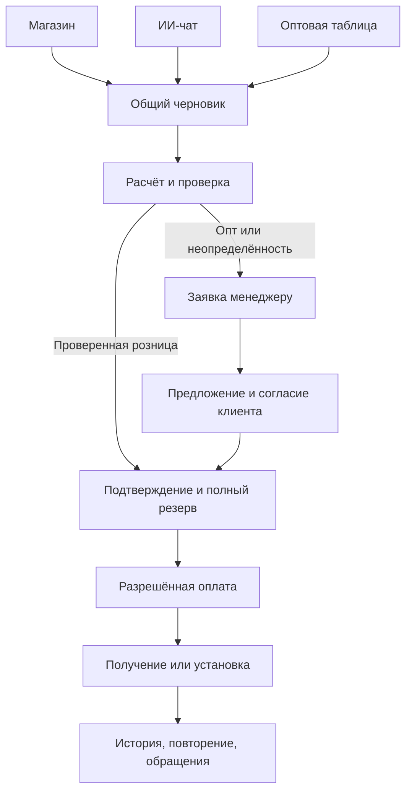

# AvtoGlass — спецификация модернизации магазина и ИИ-помощника

**Дата:** 15 сентября 2026 года.  
**Обновлено:** 21 сентября 2026 года; завершена функциональная приёмка прототипов, реализованы Money, постоянные черновики и версии расчёта с проверкой применимости и получения.  
**Статус:** согласованные продуктовые решения; техническое задание для реализации.  
**Проект:** `H:\projects\avtoglasskz`.  
**Назначение:** единый документ для разработчика, дизайнера, тестировщика и агента, реализующего изменения.

> Этот документ описывает целевую систему. Наличие требования или отмеченного этапа в документе не означает, что функция уже реализована. Чекбоксы выполнения заполняются только после проверки результата.

## Содержание

1. [Цель и согласованные решения](#1-цель-и-согласованные-решения)
2. [Результаты анализа текущего приложения](#2-результаты-анализа-текущего-приложения)
3. [Правила работы исполнителя](#3-правила-работы-исполнителя)
4. [Роли, доступ и владение данными](#4-роли-доступ-и-владение-данными)
5. [Навигация и общий дизайн](#5-навигация-и-общий-дизайн)
6. [Обычный магазин и розничное оформление](#6-обычный-магазин-и-розничное-оформление)
7. [Интерфейс ИИ-чата](#7-интерфейс-ии-чата)
8. [Оптовая закупка](#8-оптовая-закупка)
9. [Кабинет, повторение и изменение заказов](#9-кабинет-повторение-и-изменение-заказов)
10. [Общая механика заказа](#10-общая-механика-заказа)
11. [Цены, совместимость, остатки и получение](#11-цены-совместимость-остатки-и-получение)
12. [Архитектура backend](#12-архитектура-backend)
13. [Модель данных и миграции](#13-модель-данных-и-миграции)
14. [Контракты и маршруты API](#14-контракты-и-маршруты-api)
15. [Реализация frontend](#15-реализация-frontend)
16. [ИИ: инструменты, выполнение и ограничения](#16-ии-инструменты-выполнение-и-ограничения)
17. [Вход по SMS и уведомления](#17-вход-по-sms-и-уведомления)
18. [Платежи, возвраты и документы](#18-платежи-возвраты-и-документы)
19. [Импорт каталога и работа менеджера](#19-импорт-каталога-и-работа-менеджера)
20. [Производительность и наблюдаемость](#20-производительность-и-наблюдаемость)
21. [Локализация, SEO и доступность](#21-локализация-seo-и-доступность)
22. [План реализации и критерии этапов](#22-план-реализации-и-критерии-этапов)
23. [Проверки и тестовые сценарии](#23-проверки-и-тестовые-сценарии)
24. [Развёртывание, совместимость и откат](#24-развёртывание-совместимость-и-откат)
25. [Настройки, зависимости и границы выпуска](#25-настройки-зависимости-и-границы-выпуска)
26. [Критерии полной готовности](#26-критерии-полной-готовности)
27. [Источники и журнал решений](#27-источники-и-журнал-решений)

## 1. Цель и согласованные решения

Покупатель должен подобрать подходящее автостекло, понять окончательную стоимость и оформить заказ удобным способом. Обычный магазин и ИИ-чат используют один каталог, одинаковые правила цен и наличия, сохраняемые черновики и общую историю заказов.

### 1.1. Решения, принятые с владельцем

| Вопрос | Решение |
|---|---|
| Основная технология | Развивать Laravel, Livewire, Filament, PostgreSQL и Tailwind |
| Главная страница | Обычный магазин с заметным переключением в чат |
| Выбор интерфейса | Запоминать; переключение не теряет текущий черновик |
| Розничное оформление | Гибридное: проверенные случаи автоматически, остальные через менеджера |
| Оптовое оформление | Одобренный оптовик покупает проверенные позиции автоматически; исключения через менеджера |
| Оптовый кабинет | Персональные цены, ввод списком, XLSX/CSV, черновики, шаблоны, повторение, счета |
| Доступ к опту | Одобряет менеджер |
| Изменения заказа | Самостоятельно до подтверждения; после — запрос менеджеру |
| Источник цен и остатков | Учёт внутри приложения и импорт файлов |
| Вход покупателей | Код на телефон; заказ без регистрации сохраняется |
| SMS | Новый сервис для Казахстана; первый адаптер — SMSC.kz |
| Языки | Русский и казахский в обоих интерфейсах и диалоге |
| ИИ | Текстовый чат, Gemini через отдельный адаптер |
| Расчётный масштаб | До 50 000 предложений, 300 заказов в день, 100 активных покупателей одновременно |
| Внедрение | Последовательные выпуски с сохранением существующих заказов и ссылок |

### 1.2. Что считается успехом

- Один и тот же покупатель получает одинаковые условия при выборе через каталог, чат или повторение заказа.
- Интерфейс заранее объясняет, можно ли оформить заказ сейчас или требуется согласование.
- Клиент не переписывает контакты и состав при переходе между интерфейсами.
- Оптовик собирает закупку списком и видит результат её согласования в кабинете.
- Резерв, оплата и изменение заказа согласованы между собой даже при одновременных запросах.
- Скорость подтверждается измерениями на оговорённом объёме данных.

## 2. Результаты анализа текущего приложения

### 2.1. Технологическая основа

По `composer.lock` на момент анализа: Laravel `v13.26.1`, Livewire `v4.4.1`, Filament `v5.7.6`. Изначально `composer.json` указывал PHP `^8.3`; при подготовке стенда требование исправлено на `^8.4.1` по фактическим требованиям установленных зависимостей. Frontend использует Blade, Livewire, Tailwind 4 и Vite; собственного React-приложения нет.

Уже существуют:

- каталог машин, применимость, предложения производителей и импорт прайсов;
- розничная корзина и несколько способов получения;
- оптовая таблица и одобрение оптового статуса;
- кабинет и просмотр заказов;
- ИИ на Gemini с поиском и созданием заявки;
- платежные адаптеры, резервы, запись на установку, CRM и полевая панель;
- тесты каталога, заказов, платежей, опта, кабинета, ИИ и других модулей.

### 2.2. Подтверждённые наблюдения по коду

| Наблюдение | Где смотреть | Последствие для модернизации |
|---|---|---|
| Включение ИИ заменяет главную чатом | `app/Http/Controllers/HomeController.php` | Отвязать доступность чата от выбора главной |
| История ИИ хранится в сессии, до 40 сообщений | `app/Livewire/AiChat.php` | Нужны сохраняемые диалоги и серверная история |
| ИИ создаёт заявку непосредственно инструментом и получает новый UUID при каждом вызове | `app/Ai/AssistantTools.php` | Перейти на черновик и явное подтверждение; обеспечить защиту от повторного выполнения |
| Чат использует свой поиск по строке | `app/Ai/AssistantTools.php` | Объединить поиск с витриной и проверкой применимости |
| Создание заказа имеет отдельные входы для товара, корзины и опта | `app/Actions/CreateOrder.php` | Свести их к общим операциям без размножения правил |
| При нехватке может ставиться частичный резерв уже подтверждаемого заказа | `app/Catalog/StockLedger.php` | Новый автоматический путь требует полного резерва до оплаты |
| Проверка возможности оплаты не требует полного резерва | `app/Actions/StartPayment.php` | Усилить условия запуска платежа |
| `Order::isPaid()` проверяет наличие хотя бы одного успешного платежа | `app/Models/Order.php` | Разделить наличие оплаты, частичную оплату и полное погашение суммы |
| История кабинета загружается целиком | `app/Http/Controllers/CustomerCabinetController.php` | Ввести пагинацию и фильтры |
| Повторение есть только для опта | `app/Livewire/WholesaleTable.php` | Реализовать общее повторение через новый черновик |
| Выбор оптовых позиций повторно читается при расчёте итогов | `app/Livewire/WholesaleTable.php` | Один снимок данных на запрос, пакетные вычисления |
| Наличие предложения может подменяться общим наличием продукта | `app/Livewire/WholesaleTable.php` | Проверять конкретное выбранное предложение |
| Импорт и сборка каталога выполняются из запроса панели | `app/Filament/Pages/ImportPrices.php` | Перенести обработку в фоновые задания |
| Service worker кеширует успешные GET своего origin | `public/sw.js` | Ограничить кеш безопасной статикой |

### 2.3. Границы проведённой проверки

`npm run build` завершился успешно. В сборке есть предупреждение об отсутствующем необязательном `fontaine`; при работе над шрифтами либо подключить оптимизацию fallback, либо явно отключить её в настройках плагина.

Backend проверен статически. PHP отсутствовал в PATH, Docker Engine был недоступен, `http://localhost:8014` не ответил за отведённое время. Тесты PHP, визуальная проверка работающего приложения и замеры производительности в рамках анализа не выполнялись. Статусы «сделано» в старом `PLAN.md` не являются результатами нового тестового прогона.

**Дополнение от 16 сентября:** найден PHP `C:\php\php.exe` версии 8.4.23. На отдельной PostgreSQL-базе исходные 889 тестов прошли; подготовлены изолированный preview, браузерные сценарии и начальные замеры. Наблюдения таблицы выше описывают исходную версию. Подробности и ограничения проверки: [отчёт этапа 0](docs/modernization/00-baseline.md). Текущее состояние интерфейса: [первая часть этапа 1](docs/modernization/01-navigation.md).

## 3. Правила работы исполнителя

1. Перед изменениями прочитать этот документ, применимые `AGENTS.md`, текущий код и `git status`.
2. В рабочем дереве уже есть значительные изменения. Сохранять их; не выполнять общий reset, clean, массовую перезапись или возврат к HEAD.
3. `PLAN.md` сохраняется как история предыдущих решений. Для модернизации использовать эту спецификацию. Более поздние прямые указания владельца имеют приоритет.
4. Работать этапами из раздела 22. Завершённость этапа подтверждать проверками, а не только наличием интерфейса.
5. Новые бизнес-правила размещать в общих операциях приложения. Не дублировать их в Blade, Livewire, контроллере и prompt ИИ.
6. Сначала проверить существующую реализацию и тесты; переиспользовать подходящие операции платежей, документов, склада и записи.
7. Не добавлять отдельный frontend-фреймворк, микросервисы или поисковый кластер в первый выпуск.
8. Для новых сценариев добавлять содержательные тесты. Не заменять проверки расчётов и прав тестами на присутствие текста кнопки.
9. Тестировать только на выделенной тестовой БД. До запуска тестов убедиться, что эффективное подключение не указывает на рабочую базу.
10. Не вставлять в код или документацию ключи, реальные OTP, персональные данные и содержимое `.env`.
11. Обычные локальные изменения, тесты и подготовка миграций входят в реализацию. Действия с рабочей БД и внешними сервисами выполнять в пределах фактической авторизации владельца.
12. После этапа кратко сообщать: что изменено, чем проверено, что осталось и какие ограничения существенны. В спецификации обновлять только реально выполненные пункты.

## 4. Роли, доступ и владение данными

| Роль | Возможности |
|---|---|
| Гость | Каталог, розничные цены, подбор в чате, гостевой черновик, отправка розничного заказа |
| Покупатель с подтверждённым телефоном | Свои заказы, диалоги, черновики, адреса, повторение, разрешённые изменения |
| Кандидат в опт | Розничные возможности и просмотр состояния заявки на оптовый доступ |
| Одобренный оптовик | Персональные цены, оптовые спецификации, шаблоны, согласованные счета |
| Менеджер | Согласование, предложения клиенту, обработка изменений, подтверждение наличия и условий |
| Администратор | Настройки, импорт, права, одобрение опта и эксплуатационные функции согласно существующим политикам |
| Мастер / курьер | Назначенные работы и необходимые для них сведения через существующую полевую панель |

### Обязательные правила

- `BuyerContext` формируется сервером из подтверждённой клиентской сессии. Телефон, введённый в гостевой форме, не даёт оптовой скидки и прав существующего владельца номера.
- Гостевой черновик принадлежит случайному секрету в защищённой cookie; в БД хранится его хеш. Знание ID черновика не даёт доступа.
- После входа присоединять только черновики и диалоги текущего гостевого владельца. Если в аккаунте уже есть черновик, предложить выбор продолжения; не смешивать списки молча.
- Гостевой заказ хранит снимок введённых контактов. Не перезаписывать ими профиль, адреса и настройки существующего покупателя до подтверждения телефона.
- Полная история и изменение заказа требуют подтверждённого телефона и проверки владельца. Ключи и ID из текста ИИ не заменяют эту проверку.
- Старый поиск «телефон + номер заказа» не должен открывать всю историю. После миграции он показывает ограниченные сведения об одном заказе или предлагает вход по коду.
- Существующие публичные ссылки остаются ссылками ограниченного просмотра: номер, состав без персональных данных, общий статус. Они не дают права изменить заказ или получить документы с реквизитами.
- Покупатель не получает сотруднические права через вход по телефону. Клиентская и сотрудническая аутентификация проверяются отдельными guard/policy; существующий вход сотрудников сохраняется.

## 5. Навигация и общий дизайн

### 5.1. Информационная структура

- `/` — обычная главная для первого посещения.
- `/chat` — полноценный ИИ-интерфейс.
- `/catalog`, существующие страницы машин и `/tovar/{slug}` — каталог и товары.
- `/korzina` — розничный черновик и оформление.
- `/opt` — оптовая закупка.
- `/kabinet` — заказы; отдельные вкладки «Черновики», «Профиль», а для опта — «Шаблоны».
- Существующие публичные маршруты сохраняются или получают осмысленные совместимые переходы.

Выбор режима сохраняется в cookie и, после входа, в профиле. Для возвращающегося покупателя кнопка «Продолжить» открывает выбранный режим. Прямая ссылка на товар, заказ или каталог всегда открывает запрошенную страницу; не перенаправлять её принудительно в чат.

### 5.2. Общая система компонентов

- Использовать существующие токены Tailwind: цвет бренда, фон, текст, границы, состояния и интервалы.
- Основная тема — светлая; тёмная поддерживается системной настройкой и переключателем пользователя.
- Единые компоненты: поле, кнопка, количество, уведомление, карточка предложения, статус, итог, диалог подтверждения, пустое состояние, ошибка и загрузка.
- Десктоп магазина — контент и компактная колонка итогов; мобильный экран — одна колонка и закреплённое основное действие.
- Одновременно не показывать несколько плавающих кнопок поверх оформления. Помощник и связь с менеджером входят в навигацию или панель помощи.
- Размер интерактивной области кнопок и иконок — не менее 44 × 44 CSS px; основной текст — от 16 px.
- Не скрывать критические характеристики, окончательную сумму или изменение цены только внутри tooltip.
- Все состояния имеют понятный текст: «Сохраняем», «Сохранено», «Не удалось сохранить — повторить».

## 6. Обычный магазин и розничное оформление

### 6.1. Главная и поиск

На первом экране: поисковая строка, подбор по автомобилю и переход в чат. Поиск принимает еврокод, OEM, артикул предложения, название и модель автомобиля. Подсказки показывают тип совпадения и доступные категории.

Подбор автомобиля идёт по марке, модели, поколению, году и кузову. Затем уточняются значимые опции стекла. Ранее выбранный автомобиль сохраняется; смена автомобиля явно показывает, какие позиции требуют повторной проверки.

### 6.2. Результаты и карточка

- По умолчанию ранжировать точность совпадения и совместимость выше цены; среди сопоставимых предложений учитывать наличие и срок.
- Показывать конкретного производителя, цену и доступность предложения. «Есть в наличии» у другого производителя не означает наличие выбранного предложения.
- Разделять «подходит по подтверждённым данным», «нужно уточнить» и «не подходит».
- Указывать особенности камеры, датчиков, обогрева, HUD и ограничения монтажа на основании данных каталога.
- Основное действие «Оформить» добавляет выбранный вариант в розничный черновик и открывает его. Остальные позиции текущего черновика сохраняются и видны в итогах.
- Вторичное действие «Добавить» сохраняет позицию без перехода. Несколько производителей одного стекла считаются разными строками.
- При нескольких предложениях требуется явный выбор варианта либо видимый заранее выбранный вариант; сервер не заменяет его более дешёвым при отправке.
- Сравнение — до трёх предложений, только по известным характеристикам. Отсутствие данных не отображать как отсутствие функции.

### 6.3. Экран оформления

Блоки в порядке чтения:

1. Позиции, количество и сведения о совместимости.
2. Способ получения и зависимые поля.
3. Имя и телефон; для вошедшего — сохранённые контакты с действием «Изменить».
4. Доступный способ оплаты либо пояснение о согласовании.
5. Товары, услуги, доставка и общая сумма.
6. Необходимое согласие и одна кнопка отправки.

Не спрашивать повторно сведения, уже полученные из текущего черновика или подтверждённого профиля. Ошибки показывать у поля; состав и другие корректные значения сохранять. Изменение получения пересчитывает услуги и итог.

### 6.4. Два результата отправки

**Автоматический заказ:** сервер проверяет актуальный расчёт, полное наличие и получение, резервирует ресурсы, создаёт подтверждённый заказ и предлагает оплату. Способ «при получении» доступен только там, где он разрешён настройками.

**Заявка на согласование:** сервер сохраняет состав и причины проверки, создаёт задачу менеджеру, показывает номер и следующий шаг. Не показывать оплату неизвестной или предварительной суммы как завершение покупки.

Розничное оформление остаётся доступным гостю. SMS-вход не добавляется обязательным шагом перед отправкой заказа.

## 7. Интерфейс ИИ-чата

### 7.1. Компоновка

- Боковая панель: новый диалог, последние диалоги, поиск по ним, заказы, каталог, оптовая закупка при наличии доступа.
- Центр: сообщения, карточки предложений, результаты сравнения и уточняющие действия.
- Низ: многострочный ввод, отправка, отмена генерации и состояние соединения.
- На десктопе итог заказа можно открыть справа; на телефоне — отдельной нижней панелью.
- Enter отправляет, Shift+Enter переносит строку. На мобильном поле не перекрывает выбранные товары и кнопку подтверждения.

### 7.2. Диалог подбора

Пример последовательности:

1. «Нужно лобовое стекло на Camry 2018».
2. Уточнение поколения/кузова и опций, которые влияют на совместимость.
3. Поиск подтверждённых предложений и показ 2–3 вариантов.
4. Краткое объяснение различий и выбор клиентом.
5. Получение, контакты и расчёт.
6. Карточка итогов с действием «Подтвердить заказ» либо «Отправить на согласование».
7. Номер заказа, статус и допустимое следующее действие.

ИИ задаёт преимущественно один связанный вопрос за раз. Для типовых ответов использует кнопки, например «Есть камера», «Нет камеры», «Не знаю». Вариант «Не знаю» переводит неоднозначность на проверку, не угадывает комплектацию.

### 7.3. Заказы и история в чате

- «Повтори прошлый заказ» после входа предлагает выбрать заказ и создаёт новый черновик.
- «Добавь ещё два» меняет конкретную выбранную строку; при неоднозначности помощник уточняет позицию.
- «Измени адрес» применяет изменение черновика или доступного неподтверждённого заказа; для подтверждённого создаёт подготовленный запрос менеджеру после явной отправки клиентом.
- Статус, цены и доступные действия приходят из backend. Карточки старых сообщений помечаются как исторические, если условия уже изменились.
- Диалог можно переименовать и архивировать. Новый диалог не удаляет предыдущий и не очищает черновик без действия пользователя.
- По запросу человека создавать обращение менеджеру с кратким резюме и ссылкой на диалог; в интерфейсе показать, что обращение передано. Не обещать присутствие оператора в реальном времени.

## 8. Оптовая закупка

### 8.1. Таблица и черновик

Колонки: выбор, артикул/еврокод, наименование, производитель, наличие/срок, персональная цена, количество, сумма. Поиск и фильтры не сбрасывают выбранное. При выборе позиция появляется в сохраняемом черновике.

На десктопе поддержать Tab/Shift+Tab между количеством строк и вставку списка. На мобильном строки превращаются в компактные карточки. Панель итогов показывает число позиций, штук, известную сумму и позиции, для которых цена уточняется.

### 8.2. Ввод и загрузка списка

- Форматы первого выпуска: `.xlsx` и UTF-8 `.csv`; CSV принимает разделитель `;` или `,`. Старый бинарный `.xls` не входит в выпуск.
- Шаблон: обязательные `article` и `quantity`, необязательные `manufacturer` и `comment`. В примере файла дать русские и казахские пояснения колонок.
- Заголовки сопоставляются через документированный список синонимов: «Артикул», «Еврокод», «Код», «Количество», «Кол-во» и казахские подписи.
- Ограничения: файл до 20 MiB, до 1 000 входных строк и до 500 уникальных позиций в спецификации. Количество строки — 1–99; превышение возвращает ошибку, не обрезает значение.
- Пустые строки пропускать. Дубли объединять только после совпадения конкретного предложения; суммарное количество снова валидировать.
- Формулы XLSX не вычислять: в колонках кода и количества требуются буквальные значения. Архив и XML обрабатывать с ограничениями размера распаковки и числа ячеек.
- Результаты: «Найдено», «Нужно выбрать вариант», «Не найдено», «Ошибка количества».
- Неразрешённые строки остаются видны. Добавление найденных позиций выполняется отдельной кнопкой, показывающей число добавляемых и оставшихся строк.
- Автоматически не заменять производителя, артикул или неизвестный товар аналогом.

### 8.3. Согласование

Для одобренного оптовика при актуальной персональной цене, полном остатке, явно выбранных артикуле и производителе, известном получении и разрешённой автопродаже доступен `confirm_wholesale`. Перед финальным действием повторно проверяются статус, скидка, риск, цена, остаток и получение. Розничный `confirm_retail` не меняет смысл. Флаги автоматической розницы и опта независимы и по умолчанию выключены. Покупка по артикулу не является подтверждением применимости к автомобилю; установка требует проверки автомобиля.

Если хотя бы одно условие не выполнено, применяется следующий маршрут:

1. Покупатель отправляет спецификацию с получением и комментарием.
2. Менеджер проверяет цены, наличие, сроки и доставку; формирует версию предложения.
3. Покупатель видит отличия от заявки и подтверждает условия.
4. Backend ставит полный резерв и переводит заказ в подтверждённый.
5. Становятся доступны утверждённый счёт и разрешённая оплата.

При отсутствии товара менеджер согласует ожидание в заявке. Информационное предложение со сроком поставки не должно открывать оплату или обещать резерв до фактической доступности. Оплата предзаказов без полного наличия и частичные отгрузки не входят в первый выпуск.

### 8.4. Персональные условия

- Сохранить правило цены: утверждённая скидка от розницы, не ниже закупочной стоимости предложения.
- Персональную цену рассчитывать только для одобренного оптовика из текущего `BuyerContext`.
- Минимальные сумма и количество — существующие настройки CRM, по умолчанию ноль.
- Изменение скидки или оптового статуса инвалидирует неподтверждённые расчёты; принятые условия заказа сохраняются снимком.
- Один клиентский аккаунт на организацию в первом выпуске; роли сотрудников организации и цепочки согласования закупок не добавлять.

## 9. Кабинет, повторение и изменение заказов

### 9.1. Список и карточка

Кабинет открывается после входа по коду. В списке — номер, дата, розница/опт, состав кратко, итог, состояние заказа, состояние оплаты и следующее действие. По умолчанию активные заказы выше завершённых; история загружается по 20 строк.

Фильтры: период, статус, вид покупки, поиск по номеру и наименованию. Фильтры отражаются в URL. Полная карточка загружается по запросу, а не для всех заказов сразу.

Карточка показывает снимок состава, получение, оплату, доступные документы, историю изменений, предложения менеджера и обращения. Не показывать покупателю внутренние комментарии, закупочные цены и служебные причины отказа провайдера.

### 9.2. Повторение

- Любой свой розничный или оптовый заказ можно повторить в новый черновик соответствующего типа.
- Сохранить ссылку `repeated_from_order_id` для аналитики; исходный заказ не изменять.
- Повторять товарные позиции по конкретным предложениям. Услуги, доставку, скидки и суммы рассчитать заново.
- Удалённые позиции отображать отдельными неразрешёнными строками по снимку старого заказа.
- Не подменять недоступное предложение аналогом без выбора покупателя.
- Адрес предложить из профиля; дату и слот не копировать. Проверить автомобиль и совместимость заново.
- Итог показывает изменения цен и доступности до подтверждения.

### 9.3. Правила редактирования

| Состояние | Действие покупателя |
|---|---|
| Черновик | Свободно изменить или удалить |
| `new`, `in_progress`, без принятого подтверждения | Изменить состав, количество, получение; отправить новую версию |
| Менеджер уже прислал предложение, но клиент не принял | Изменить заявку; старое предложение становится недействительным |
| `confirmed`, `scheduled` | Отправить запрос изменения или отмены менеджеру |
| `completed`, `cancelled` | Просмотр и повторение; исходный заказ не редактируется |

Для автоматической розницы подтверждение происходит при финальном действии клиента и успешном резервировании. После этого изменения идут через менеджера, даже если онлайн-оплата ещё не завершена.

Дополнительное ограничение для старых данных: наличие успешного платежа, незавершённой платёжной попытки или начатого исполнения запрещает прямое клиентское редактирование даже при статусе `new`/`in_progress`. Такой заказ изменяется через менеджера и общую операцию пересчёта.

Менеджер рассматривает запрос, готовит новую версию условий или отклоняет с понятной причиной. До принятия новой версии действует текущий заказ. При одновременном изменении вернуть конфликт версии и показать свежий заказ.

До подтверждения самостоятельная отмена допустима, если нет платежа и активного исполнения. После подтверждения отмена оформляется запросом. Уменьшение суммы оплаченного заказа создаёт отдельный возврат; новая сумма сама по себе не означает возврат денег.

## 10. Общая механика заказа

### 10.1. Термины

- **Черновик (`OrderDraft`)** — сохраняемый набор позиций и предпочтений до отправки.
- **Расчёт (`CheckoutQuote`)** — неизменяемый снимок условий для конкретной версии черновика или заказа.
- **Заявка** — заказ, требующий проверки менеджером; имеет номер и историю, но ещё не подтверждён.
- **Подтверждение** — принятие условий клиентом и успешная проверка/резервирование ресурсов сервером.
- **Предложение менеджера** — версия расчёта, которую клиент может принять или попросить изменить.
- **Запрос изменения** — самостоятельная сущность с описанием предлагаемых изменений и результатом рассмотрения.

### 10.2. Схема



### 10.3. Инварианты

1. Одно финальное действие пользователя создаёт не более одного заказа.
2. Заказ фиксирует конкретные предложения и цены; повторный запрос не меняет их незаметно.
3. Ни ИИ, ни браузер не определяют итоговую цену и оптовый статус.
4. Неизвестная стоимость остаётся неизвестной и запрещает автоматическую оплату.
5. Опт всегда требует рассмотрения менеджером.
6. Новое подтверждение требует полного резерва товарных позиций и необходимых слотов.
7. Изменение цены, состава, доставки или персональных условий делает прежний неподтверждённый расчёт недействительным.
8. Подтверждённый заказ изменяется только через согласованную новую версию.
9. История платежей и возвратов не переписывается при изменении заказа.
10. Уведомления и внешние HTTP-вызовы не выполняются под блокировкой строк БД.

### 10.4. Транзакции и конкурентные запросы

- Команды записи принимают ключ повторяемости (`Idempotency-Key`) и ожидаемую версию изменяемой сущности.
- Для одинаковых владельца, операции и ключа возвращать прежний результат. Тот же ключ с другим содержимым — `409 IDEMPOTENCY_CONFLICT`.
- Ключ финальной покупки относится к пользовательскому намерению и версии расчёта. Повтор HTTP-запроса и повтор вызова ИИ не генерируют новый ключ.
- Проверку условий, изменение заказа, резервов и запись события выполнять в одной транзакции.
- При операциях с несколькими ресурсами использовать единый порядок блокировок: заказ/черновик, затем предложения по возрастанию ID, затем ресурсы расписания по ID и времени, затем платежные записи.
- Пересмотреть текущие платёжные обработчики под этот порядок; не смешивать разные порядки блокировок между callback, оплатой наличными и изменением заказа.
- Ошибка резервирования откатывает всё подтверждение. Частичный успех не сохраняется в автоматическом пути.
- События для фоновых действий сохранять в таблице outbox в той же транзакции. Отдельный обработчик доставляет их в очередь с защитой потребителей от повторов.

### 10.5. Статусы и переходы

Черновик хранится отдельно от `orders`; его состояния — `active`, `submitted`, `archived`. Повторение создаёт новый `active`, не возвращает отправленный черновик в работу.

| Переход заказа | Условие |
|---|---|
| Создание → `new` | Отправлена заявка на согласование |
| `new` → `in_progress` | Менеджер начал проверку либо обрабатывает предложение |
| Создание / `new` / `in_progress` → `confirmed` | Клиент принял действующие условия, полный резерв и получение проверены |
| `confirmed` → `scheduled` | Зафиксировано назначение доставки или установки |
| `confirmed` / `scheduled` → `completed` | Исполнение подтверждено сотрудником; соблюдены условия оплаты/расчёта при получении |
| Нефинальный → `cancelled` | Разрешённая отмена, освобождение ресурсов и фиксация необходимых финансовых действий |

Для нового сценария не использовать прямой переход `new` → `scheduled` как замену проверки товара. До подтверждения выбранное клиентом время — пожелание или краткосрочный hold, а не обещанное исполнение. Совместимость старых записей расписания сохраняется.

Предложение менеджера становится `accepted` только при успешном принятии его условий. При редактировании заявки прежнее предложение — `superseded`; после срока — `expired`. Запрос изменения проходит `submitted` → `in_review` → `awaiting_customer` → `applied`, либо `rejected`/`withdrawn`. Ни `awaiting_customer`, ни `applied` не подменяют фактическое состояние доплаты/возврата.

Состояние оплаты вычисляется отдельно: `unpaid`, `pending`, `partially_paid`, `paid`, `refund_pending`, `partially_refunded`, `refunded`. «Есть успешный платёж» и «заказ полностью оплачен» — разные проверки. Изменение этой логики требует регрессии наличных, кассы, фискализации и удержания резерва.

## 11. Цены, совместимость, остатки и получение

### 11.1. Деньги

- В API и вычислениях использовать `Money` с целым количеством минимальных денежных единиц и валютой `KZT`. Пример: 25 000 ₸ = `2500000` минимальных единиц.
- Существующие PostgreSQL `numeric/decimal` сохранять; преобразование в целые единицы выполнять из десятичной строки, без промежуточного `float`.
- Скидку применять к единичной цене и округлять half-up до двух знаков, затем умножать на количество. Оптовый минимум по закупочной цене проверять после скидки.
- Сумма заказа складывается из товарных строк, услуг и доставки. Не дублировать стоимость монтажа одновременно строкой и отдельным прибавлением.
- Не менять существующий налоговый режим компании и фискальные правила в рамках редизайна. Отдельно проверить согласованность суммы заказа, счёта и чека.

### 11.2. Актуальность данных

Добавить предложение с признаками `auto_checkout_enabled`, `stock_verified_at`, `price_valid_until`. По умолчанию старые предложения не считаются допущенными к автоматической продаже.

- Для автоматической продажи проверка остатка не старше 24 часов; порог настраивается.
- Цена считается актуальной до явно заданного `price_valid_until`.
- Обновление прайса без количества не обновляет время проверки остатка.
- Резервы и списания приложения учитываются немедленно независимо от даты внешнего прайса.
- Актуальный расчёт действует 15 минут, но подтверждение всегда перепроверяет факты. При изменении условий возвращается новая версия для явного принятия.
- `expires_at` расчёта применяется до принятия. После принятия условия сохраняются в заказе и не пересчитываются из-за истечения этих 15 минут или нового прайса.
- Менеджер может подготовить ручное предложение с явно проверенными данными; оно не обходится одной галочкой «подтвердить» при отсутствии полного количества.

### 11.3. Совместимость

Использовать существующие `fitments.is_verified`, модель, поколение, год, кузов и известные опции. Выделить режим выбора: `vehicle_fitment` или `exact_article`.

- В режиме автомобиля автоматический путь требует подтверждённой применимости и необходимых уточнений комплектации.
- В режиме точного артикула клиент явно подтверждает выбор кода и производителя; интерфейс не утверждает, что совместимость с конкретным автомобилем проверена.
- VIN первого выпуска служит идентификатором и подсказкой. Не обещать полную расшифровку модели и комплектации по существующему локальному алгоритму.
- Неизвестный год, опция или непроверенная применимость возвращают причину `FITMENT_REVIEW_REQUIRED`.
- Изображение и рекламное описание не являются источником технической совместимости.

### 11.4. Получение

| Тип | Обязательные данные | Автоматический путь |
|---|---|---|
| `pickup` | Город, доступная точка выдачи | Если предложение доступно для этой точки по настройкам |
| `delivery` | Город, адрес, контакт получателя | Только при определяемом тарифе и разрешённой зоне |
| `installation` | Точка, автомобиль, работа, слот | При подтверждённой применимости, цене работ и свободном слоте |
| `visit` | Город, адрес, автомобиль, работа, слот | При разрешённой зоне, цене выезда и свободном ресурсе |

В первом выпуске сохраняется единый учёт остатков приложения. Города и точки определяют допустимость получения, а не выдуманные независимые склады. Не показывать остаток по конкретному городу, если такой учёт отсутствует.

Заказ имеет один способ получения и один слот установки. Позиции, требующие разных получений или нескольких автомобилей, направляются на согласование. Существующую запись на услугу без покупки стекла сохранить отдельным поддерживаемым сценарием с теми же проверками цены и слота.

### 11.5. Резервы

- Онлайн-оплата: полный временный резерв на 15 минут.
- Согласованный счёт или оплата при получении: срок из настройки, по умолчанию три дня. Для назначенной услуги менеджер явно согласует срок резерва с датой исполнения.
- Оплата закрепляет имеющийся резерв до исполнения или согласованной отмены.
- Задание освобождения временных онлайн-резервов выполняется каждую минуту; существующий часовой проход недостаточен для 15-минутного срока.
- Повторное подтверждение не удваивает резерв. Освобождение не затрагивает оплаченные заказы без отдельного решения.
- Истёкший резерв делает заказ недоступным к оплате до повторного подтверждения наличия; интерфейс предлагает обновить условия.
- После истечения резерва сохранить номер и принятый снимок заказа, установить причину проверки. Повторный резерв с теми же доступными условиями можно восстановить общей операцией; изменение суммы требует нового предложения и согласия клиента.
- Уже существующие частично обеспеченные заказы не отменяются миграцией. Они помечаются для проверки и обслуживаются отдельным совместимым путём.

## 12. Архитектура backend

### 12.1. Модульная структура

Приложение остаётся единым Laravel-проектом. Новые классы размещать в `app/Domain/<Module>`; существующие классы переводить постепенно через адаптеры, без массового переименования ради структуры.

| Модуль | Ответственность |
|---|---|
| Catalog | Поиск, предложения, применимость, публикация и нормализация |
| Pricing | Розничные и персональные цены, Money, версии расчёта |
| Checkout | Черновики, получение, подготовка и отправка заказа |
| Orders | Состояния, согласование, повторение, изменения и журнал |
| Inventory | Проверенный остаток, резервы, освобождение и списание |
| Fulfillment | Точки, тарифы, доступные услуги и расписание |
| Payments | Попытки платежа, callback, сверка и возвраты |
| Customers | OTP, подтверждённый профиль, адреса и оптовый доступ |
| Assistant | Диалоги, инструменты, очередь генерации и адаптер Gemini |

### 12.2. Границы слоёв

- HTTP и Livewire: аутентификация, разбор входа, FormRequest, вызов операции, отображение результата.
- Операции приложения: авторизация конкретного действия, транзакции и управление бизнес-сценарием.
- Доменные правила: расчёты, условия подтверждения, допустимость изменений и совместимость.
- Адаптеры: SMS, Gemini, платежные системы, уведомления, хранилища и очереди.

В доменных расчётах не читать `request()`, `session()` или глобального текущего покупателя. Передавать явный `BuyerContext`. Старые helper-функции допустимы в адаптерах интерфейса на время миграции.

### 12.3. Операции первого выпуска

`SearchOffers`, `CheckFitment`, `CreateDraft`, `UpdateDraft`, `QuoteDraft`, `SubmitDraft`, `PrepareProposal`, `AcceptProposal`, `RepeatOrder`, `UpdateUnconfirmedOrder`, `RequestOrderChange`, `ApproveOrderChange`, `CancelUnconfirmedOrder`, `StartOrderPayment`, `ApplyPaymentEvent`, `RequestOtp`, `VerifyOtp`, `SendAssistantMessage`.

Старый `CreateOrder` становится совместимым входом к этим операциям. Он не должен сохранять отдельные правила цены, скидки или резервов для старых форм.

## 13. Модель данных и миграции

Это минимальные целевые сущности. Перед созданием миграции сопоставить их с существующими таблицами и переиспользовать уже имеющиеся поля; не создавать вторую таблицу с тем же смыслом.

| Сущность | Основные данные и ограничения |
|---|---|
| `order_drafts` | UUID, владелец customer/guest, `sales_mode`, `version`, автомобиль, контакты, получение, locale, состояние, даты |
| `order_draft_items` | Черновик, предложение либо неразрешённая ссылка, количество, снимок исходного кода, причина проверки |
| `checkout_quotes` | UUID, черновик/заказ, версия, снимок строк и итогов, reasons, `expires_at`, автор, состояния prepared/accepted/superseded/expired |
| `order_proposals` | Заказ, ссылка на расчёт, номер версии, автор менеджер, pending/accepted/rejected/superseded/expired |
| `order_change_requests` | Заказ, базовая версия, предлагаемые изменения, клиентский комментарий, менеджер, состояние и связанные расчёт/возврат |
| `payment_refunds` | Платёж, сумма, причина, состояние, уникальный ключ операции, provider_reference и отметка legacy-миграции |
| `order_events` | Заказ, номер последовательности, тип события, актор, безопасные структурированные изменения, признак видимости клиенту |
| `purchase_templates` | Покупатель, название, список предложений и количеств, версия; цены не фиксируются |
| `customer_addresses` | Владелец, город, адрес, получатель, телефон и признак основного |
| `customer_vehicles` | Владелец, модель/поколение/год/кузов, VIN при наличии, явно известные опции |
| `conversations` | UUID, владелец, locale, название, архив, ссылка на текущий черновик |
| `conversation_messages` | Диалог, порядковый номер, роль, тип, текст или безопасный payload карточки, turn_id |
| `assistant_turns` | UUID, диалог, состояние queued/running/completed/failed/cancelled, модель, usage, ошибка без секретов |
| `otp_challenges` | UUID, нормализованный телефон, HMAC кода, expiry, число попыток, used_at, контекст отправки |
| `idempotency_records` | Владелец, операция, ключ, хеш входа, ссылка на результат; составной уникальный индекс |
| `outbox_events` | Тип, агрегат, payload, уникальный event_id, состояние доставки, число попыток |
| `wholesale_list_imports` | Владелец, приватный файл, состояние, число строк, результаты сопоставления |

### Изменения существующих сущностей

- `orders`: версия, `sales_mode` retail/wholesale, `channel` catalog/chat/manager/booking, accepted_quote_id, repeated_from_order_id, снимок контактов, `review_required` и причина.
- `offers`: явная пригодность к автоматической продаже, проверка остатка, актуальность цены. Индексировать поиск по `article` с учётом используемой нормализации.
- `users/customers`: подтверждение телефона, locale, предпочтительный интерфейс. Не добавлять дублирующую независимую систему клиентов.
- `order_items`: сохранять снимок артикула и типа строки product/service/delivery, чтобы повторение не теряло идентификацию удалённого товара.
- Попытки платежа связывать с версией подтверждённых условий; успешный платёж относится к снимку суммы, а не к произвольно изменяемому текущему итогу.
- Для редактируемого клиентского контента товаров/услуг/точек добавить `translations` JSONB; существующие поля остаются русским источником на период миграции.
- Существующие `OrderStatus` и `PaymentStatus` не переименовывать в первой миграции. Согласование, резерв и необходимость проверки отражаются отдельными сущностями/полями.

### Индексы и хранение

- История: `(customer_id, created_at, id)`; запросы изменений: `(order_id, status)`; события: unique `(order_id, sequence)`.
- Диалоги: владелец и дата; сообщения: unique `(conversation_id, sequence)`; активный turn — не более одного на диалог.
- Индексы фильтров и поиска уточнять по `EXPLAIN ANALYZE` на тестовых данных; не индексировать все поля без проверенного запроса.
- Гостевые неактивные черновики и диалоги очищать через 30 дней. Диалоги аккаунта — через 180 дней без активности, с предупреждением о сроке в настройках хранения.
- Чаты, связанные с незавершённым обращением, не очищать до его закрытия. Заказы, платежи и документы не удалять этим заданием.
- Файлы оптового импорта и подробные результаты хранить 7 дней; коды OTP удалять после короткого служебного периода, не хранить текст кода.
- Для завершённых операций создания заказа сохранять уникальную связь намерения и результата в самом заказе; очистка вспомогательного кеша ключей не должна разрешать дубль.

## 14. Контракты и маршруты API

### 14.1. Общие соглашения

Это API собственного сайта, размещённое на том же origin. Маршруты `/api/v1` подключаются с session/cookie middleware и CSRF-защитой для команд записи. Не использовать стандартную stateless-группу Laravel без явной настройки клиентской аутентификации. Публичный API для сторонних покупателей в первый выпуск не входит.

- Внешние идентификаторы черновиков, расчётов, диалогов и заказов — UUID/public ID; проверка владельца обязательна независимо от сложности ID.
- Запись принимает `Idempotency-Key`; изменение существующей сущности дополнительно принимает `expected_version`.
- Операции чтения не создают заказ, платёж, запрос изменения или новый диалог.
- Момент времени передаётся ISO 8601 с timezone; хранение — UTC. Отображение и расписание используют timezone выбранной точки, по умолчанию `Asia/Qyzylorda`.
- Число штук — целое. Деньги — `{ "amount_minor": 2500000, "currency": "KZT" }`.
- `null` означает неизвестное значение, а не ноль. Нельзя платить расчёт, где хотя бы одна обязательная составляющая неизвестна.
- Клиент получает только разрешённые публичные поля. Не сериализовать Eloquent-модель предложения целиком: она содержит закупочную цену и внутренние данные.
- `locale` допускает `ru` и `kk`; язык ошибок совпадает с языком интерфейса. Машинные коды ошибок не переводятся.
- Успех: `{ "data": ..., "meta": { "request_id": "..." } }`.
- Ошибка: `{ "error": { "code": "...", "message": "...", "fields": {} }, "meta": { "request_id": "..." } }`.

### 14.2. DTO

| Контракт | Содержимое |
|---|---|
| `BuyerContext` | Серверный actor, customer_id, guest_owner, разрешённый sales_mode, персональные условия, locale |
| `OrderDraft` | ID, version, sales_mode, строки, автомобиль, контакты, получение, validation_issues |
| `CheckoutQuote` | ID, версия источника, строки и Money, сумма/известная часть, readiness, reasons, expiry, условия получения |
| `OrderView` | Public ID, номер, версия, состояния заказа/оплаты/получения, snapshot, allowed_actions, безопасная история |
| `OrderChangeRequest` | ID, базовая версия, предлагаемые изменения, состояние, предложение менеджера и публичная причина решения |
| `AssistantMessage` | ID, sequence, role, type=text/products/comparison/quote/order/status, безопасный payload |

`allowed_actions` вычисляется backend. Скрытая кнопка не является контролем прав: команда повторно проверяет право выполнить действие.

### 14.3. Основные маршруты

| Метод и маршрут | Назначение | Доступ |
|---|---|---|
| `GET /api/v1/offers` | Общий поиск, фильтры, пагинация | Гость / покупатель; цены по контексту |
| `POST /api/v1/fitment/check` | Проверка выбранной машины и предложения | Гость / покупатель |
| `POST /api/v1/drafts` | Новый черновик retail/wholesale | Wholesale только одобренному |
| `GET /api/v1/drafts/{draft}` | Состояние своего черновика | Владелец |
| `PATCH /api/v1/drafts/{draft}` | Пакетное изменение состава/данных | Владелец + версия |
| `POST /api/v1/drafts/{draft}/quotes` | Получить сохранённую версию расчёта | Владелец |
| `POST /api/v1/drafts/{draft}/submit` | Подтвердить проверенную розницу или отправить заявку | Владелец + расчёт + версия |
| `GET /api/v1/orders` | История с фильтрами | Подтверждённый покупатель |
| `GET /api/v1/orders/{order}` | Полная карточка | Подтверждённый владелец |
| `PATCH /api/v1/orders/{order}` | Изменить неподтверждённую заявку | Владелец + версия + разрешённое состояние |
| `POST /api/v1/orders/{order}/repeat` | Новый черновик по заказу | Владелец |
| `POST /api/v1/orders/{order}/cancel` | Отменить неподтверждённый заказ | Владелец + версия + проверки |
| `POST /api/v1/orders/{order}/change-requests` | Передать изменение подтверждённого заказа | Владелец |
| `POST /api/v1/orders/{order}/proposals/{proposal}/accept` | Принять предложение менеджера | Владелец + версия |
| `POST /api/v1/orders/{order}/payments` | Начать/продолжить допустимую оплату | Владелец или ограниченная сессия создателя гостевого заказа |
| `GET /api/v1/orders/{order}/documents/{document}` | Скачать разрешённый готовый документ | Подтверждённый владелец |
| `POST /api/v1/wholesale/imports` | Загрузить список | Одобренный оптовик |
| `GET /api/v1/wholesale/imports/{import}` | Состояние и сопоставление | Владелец |
| `PATCH /api/v1/wholesale/imports/{import}` | Разрешить неоднозначные строки | Владелец + версия |
| `POST /api/v1/wholesale/imports/{import}/apply` | Добавить выбранные строки в черновик | Владелец + версия черновика |
| `POST /api/v1/auth/otp/request` | Запрос кода | Ограничение частоты |
| `POST /api/v1/auth/otp/verify` | Проверка и открытие клиентской сессии | Действующий challenge |
| `POST /api/v1/auth/logout` | Выход и очистка доступа текущей сессии | Покупатель |
| `GET /api/v1/conversations` | Список своих диалогов | Владелец |
| `POST /api/v1/conversations` | Новый диалог | Гость / покупатель |
| `PATCH /api/v1/conversations/{conversation}` | Название или архив | Владелец + версия |
| `GET /api/v1/conversations/{conversation}/messages` | История по курсору | Владелец |
| `POST /api/v1/conversations/{conversation}/messages` | Сохранить сообщение и поставить генерацию в очередь | Владелец |
| `GET /api/v1/assistant/turns/{turn}/events` | SSE-поток состояния и ответа | Владелец |
| `POST /api/v1/assistant/turns/{turn}/cancel` | Отменить текущую генерацию | Владелец |

Профиль, адреса, автомобили и шаблоны закупки используют ресурсные маршруты `/profile`, `/addresses`, `/vehicles`, `/purchase-templates` в той же группе с проверкой владельца. Платёжные callback сохраняют существующие адреса и подписи провайдера. Команды менеджера вызываются из Filament через те же операции; клиентский API не открывает полномочия менеджера.

### 14.4. Пример расчёта и подтверждения

```json
{
  "data": {
    "id": "00000000-0000-4000-8000-000000000101",
    "draft_id": "00000000-0000-4000-8000-000000000001",
    "draft_version": 7,
    "readiness": "ready",
    "reasons": [],
    "items": [
      {
        "offer_id": 120,
        "quantity": 1,
        "unit_price": { "amount_minor": 2500000, "currency": "KZT" },
        "total": { "amount_minor": 2500000, "currency": "KZT" }
      }
    ],
    "goods_total": { "amount_minor": 2500000, "currency": "KZT" },
    "services_total": { "amount_minor": 0, "currency": "KZT" },
    "delivery_total": { "amount_minor": 0, "currency": "KZT" },
    "total": { "amount_minor": 2500000, "currency": "KZT" },
    "expires_at": "2026-09-15T10:15:00Z"
  },
  "meta": { "request_id": "example-request" }
}
```

Пример условный: 25 000 ₸ за одну позицию с самовывозом. Значения не являются фактическими ценами каталога.

```json
{
  "quote_id": "00000000-0000-4000-8000-000000000101",
  "expected_version": 7,
  "action": "confirm_order",
  "privacy_consent": true
}
```

Для ручной проверки клиент отправляет `action: "submit_for_review"`. При изменившейся готовности сервер возвращает обновлённый расчёт и предлагает нужное действие; не переключает незаметно подтверждение покупки на заявку с другими условиями.

### 14.5. Ошибки и состояния

| Код | Реакция интерфейса |
|---|---|
| `422 VALIDATION_FAILED` | Ошибки у полей, остальные данные сохранены |
| `409 VERSION_CONFLICT` | Показать свежие данные и предложить повторить изменение |
| `409 QUOTE_EXPIRED` | Обновить расчёт; повторно подтвердить условия |
| `409 PRICE_CHANGED` | Показать прежний и новый итог |
| `409 STOCK_CHANGED` | Выделить дефицитные строки и доступное количество |
| `409 SLOT_TAKEN` | Предложить новые слоты, сохранить состав |
| `409 IDEMPOTENCY_CONFLICT` | Не повторять автоматически с новым ключом; восстановить результат операции |
| `401 AUTH_REQUIRED` | Вход по коду с возвратом к текущему действию |
| `403 WHOLESALE_REQUIRED` | Объяснить состояние оптового доступа |
| `404 RESOURCE_NOT_FOUND` | Одинаковый ответ для чужого и отсутствующего приватного ресурса |
| `429 RATE_LIMITED` | Срок ожидания через `Retry-After` |
| `503 DEPENDENCY_UNAVAILABLE` | Понятное сообщение, сохранённое состояние и безопасное повторение |

Причины ручной проверки — элементы расчёта, а не ошибки HTTP: `WHOLESALE_REVIEW_REQUIRED`, `FITMENT_REVIEW_REQUIRED`, `PRICE_UNCONFIRMED`, `STOCK_UNCONFIRMED`, `DELIVERY_REVIEW_REQUIRED`, `SERVICE_REVIEW_REQUIRED`.

## 15. Реализация frontend

### 15.1. Подход

Использовать Blade для серверного каркаса и индексируемого контента, Livewire 4 для интерактивных сценариев и Alpine/небольшие JS-модули для локальных действий интерфейса. Не превращать обычные открытия меню и вкладок в серверные запросы.

Выделить компоненты уровня сценария:

- `StorefrontSearch`, `VehiclePicker`, `OfferCard`, `OfferComparison`;
- `DraftSummary`, `CheckoutForm`, `FulfillmentPicker`, `QuoteConfirmation`;
- `WholesaleWorkspace`, `ListImportReview`, `PurchaseTemplates`;
- `OrderList`, `OrderDetail`, `OrderRevisionDiff`, `ChangeRequestForm`;
- `ChatShell`, `ConversationList`, `MessageThread`, `ProductMessage`, `QuoteMessage`;
- `PhoneLogin`, `OtpInput`, `AddressPicker`.

Имена описывают назначение и могут соответствовать Blade/Livewire-компонентам; не создавать одновременно два разных компонента для одинакового расчёта только из-за канала входа.

### 15.2. Работа с состоянием

- Авторитетный черновик хранится на сервере. Локальное состояние содержит несохранённый ввод и последнюю известную версию.
- Изменение количества оптимистично отражается в интерфейсе; итог помечается как предварительный до ответа сервера.
- Автосохранение текстовых полей — через 700 мс после ввода; поиск — через 350 мс. Переключение фильтра не отменяет сохранение черновика.
- При сетевой ошибке сохранять несохранённый ввод в памяти открытой страницы и давать повторить. Не сообщать «Сохранено» до ответа сервера.
- Контакты и переписку не складывать в общий `localStorage`. Для восстановления между устройствами используется сервер после входа.
- Изменение в другой вкладке обнаруживается по версии. Нельзя молча заменять чужую свежую редакцию устаревшим payload.
- Тексты сообщений экранировать; если используется Markdown, разрешить только безопасное подмножество. Карточки строить из валидированных структур, а не HTML модели.

### 15.3. Состояния и UX-проверки

Для каждого ключевого компонента реализовать normal/loading/empty/error/disabled/conflict и восстановление после ошибки. Skeleton сохраняет размеры блока. При загрузке не удалять выбранные фильтры и строки.

После подтверждения показывать номер и фактический результат: «Заказ подтверждён» или «Заявка отправлена на согласование». Закрытие вкладки банка и возврат на сайт не считать подтверждением успешной оплаты.

## 16. ИИ: инструменты, выполнение и ограничения

### 16.1. Инструменты первого выпуска

| Инструмент | Разрешённое действие |
|---|---|
| `search_offers` | Поиск через общий каталог по машине, кодам и фильтрам |
| `check_fitment` | Проверка применимости и список недостающих сведений |
| `compare_offers` | Сравнение известных характеристик предложений |
| `get_draft` | Чтение текущего черновика владельца |
| `update_draft` | Изменение выбранных строк и предпочтений по запросу клиента |
| `quote_draft` | Подготовка расчёта и карточки подтверждения |
| `list_orders` / `get_order` | Чтение своих заказов после входа |
| `prepare_repeat` | Создание нового черновика по выбранному своему заказу |
| `prepare_change_request` | Подготовка формы запроса изменения для отправки клиентом |
| `request_manager` | Передача явно запрошенного обращения менеджеру |

Финальное создание заказа, начало оплаты, отмена и отправка запроса изменения вызываются явным UI-действием через общие команды. Инструмент `create_order`, принимающий подтверждение от модели, из нового пути удалить.

### 16.2. Серверный контекст

- Передавать в модель язык, выбранный автомобиль, краткое резюме диалога, релевантные сообщения и безопасные результаты инструментов.
- Полную историю, `BuyerContext` и права хранить серверно. Поля Livewire из браузера не являются достоверной историей разговора.
- Имена, телефоны и адреса собирать структурированными полями по возможности. В модель передавать минимум, нужный для продолжения: например, «контакты заполнены».
- Перед каждым инструментом проверять аргументы, право доступа и актуальность выбранного черновика.
- Данные каталога, импортированный текст и пользовательские сообщения не могут переопределить правила вызова инструментов.
- Не предоставлять модели SQL, shell, произвольный HTTP или список всех клиентов.

### 16.3. Фоновое выполнение и поток ответа

1. POST сообщения сохраняет пользовательское сообщение и `assistant_turn`, возвращает `202` с turn_id.
2. Задание очереди `ai` получает серверную историю и вызывает Gemini с общим бюджетом времени.
3. Промежуточные события пишутся в Redis Stream; итоговые сообщения, результаты действий и состояние turn сохраняются в PostgreSQL.
4. Авторизованный SSE GET отдаёт `status`, `text_delta`, `card`, `completed`, `failed`. Не отдавать ключи, сырые системные инструкции и внутренние payload инструментов.
5. Каждое событие имеет ID. При переподключении использовать `Last-Event-ID`; при отсутствии буфера вернуть сохранённый итог и текущее состояние.
6. Для окружений без SSE использовать короткий опрос состояния раз в секунду только во время активного turn. Не держать постоянный polling на закрытом чате.
7. Отмена переводит turn в cancelled; воркер проверяет отмену между этапами. Уже сохранённое изменение черновика остаётся видимым и не маскируется как отменённое.

Один диалог обрабатывает одно сообщение за раз. Повтор того же сообщения с тем же ключом возвращает текущий turn. Прерывание потока не перезапускает генерацию автоматически и не выполняет инструменты второй раз.

### 16.4. Начальные ограничения

- До 2 000 символов в одном пользовательском сообщении.
- До 5 последовательных шагов инструментов и 30 секунд общего времени на turn, включая ожидание внешнего API после старта воркера.
- До 2 попыток обращения к разрешённым моделям в пределах общего времени; не перемножать список ключей и моделей в длинную серию ожиданий.
- Не более 20 новых сообщений в минуту на пользователя/гостевого владельца; дополнительно ограничить по IP и общий параллелизм.
- Начальный общий параллелизм генераций — 10. При насыщении показать очередь; обычный checkout продолжает работать.
- ID основной и резервной моделей задаются конфигурацией и проверяются на доступность. Не угадывать названия моделей по номеру следующей версии.
- Учитывать входные/выходные токены, длительность, ошибки и оценочную стоимость по конфигурируемым тарифам. Дневной и месячный денежный лимит обязателен перед включением ИИ на рабочем сайте.
- При исчерпании лимита или недоступности провайдера сохранять состояние и предлагать каталог/обращение менеджеру. Не обещать результат неисполненного инструмента.

### 16.5. Правила ответа

ИИ отвечает на языке текущего диалога, преимущественно кратко, с конкретным следующим шагом. Цена, наличие, срок и совместимость сообщаются только из результатов backend. При нескольких равно подходящих вариантах сначала объясняется практическая разница, затем предлагается выбор. Сопутствующие товары не добавляются без выбора клиента.

## 17. Вход по SMS и уведомления

### 17.1. Последовательность входа

1. Нормализовать телефон, проверить допустимый формат и ограничения отправки.
2. Создать challenge со случайным шестизначным кодом. Хранить keyed hash/HMAC кода с серверным секретом, а не открытый код.
3. Отправить служебное SMS через адаптер `SmsSender`; первый драйвер — SMSC.kz.
4. Проверить код в пределах срока, атомарно отметить использование, открыть клиентскую сессию и сменить её ID.
5. Найти/создать клиентский аккаунт с подтверждённым номером и безопасно привязать его карточку. Дубли и конфликт существующих связей направить на ручное разрешение, не объединять разные аккаунты произвольно.
6. Вернуть пользователя к исходному заказу, кабинету или черновику.

До успешного OTP не сообщать, существует ли аккаунт и какие у него заказы. Клиентские учётные записи не получают роль сотрудника даже при совпадении номера со служебной записью.

### 17.2. Ограничения

- Код действует 5 минут и применяется однократно.
- Повторная отправка через 60 секунд; не более 5 отправок в час и 10 в сутки на телефон, 30 в час на IP как начальная настройка.
- До 5 неверных вводов на challenge; дополнительно 10 неверных вводов за 15 минут на телефон. Новый challenge не обнуляет ограничение телефона.
- Повторная отправка инвалидирует прежний код. Ответ на дублирующий запрос отправки с тем же ключом не создаёт новое SMS.
- OTP, API-ключ, полный текст SMS и секрет гостевого владельца не попадают в логи.
- На тестовом стенде использовать fake-драйвер и известные тестовые сценарии; не отправлять реальные SMS при обычном прогоне тестов.

### 17.3. Виды уведомлений

- SMS первого выпуска используется для OTP. Рассылку маркетинга и массовые SMS о статусах не добавлять.
- Клиентские события появляются в кабинете и связанном диалоге. Email о важных событиях использовать при подтверждённом адресе и включённом канале.
- Сотрудникам сохранить имеющиеся настроенные каналы Telegram/WhatsApp/email через общую очередь уведомлений.
- Для одного события и получателя вести delivery record, чтобы повтор задания не отправлял повторное уведомление.
- Невозможность отправить уведомление не откатывает созданный заказ. Ошибка видна менеджеру и повторяется по ограниченной политике.

## 18. Платежи, возвраты и документы

### 18.1. Оплата

- Переиспользовать существующие адаптеры Halyk/FreedomPay/Kaspi и другие фактически подключённые драйверы. Доступные варианты показывает конфигурация, а не жёстко заданный переход в Halyk.
- Новая оплата допустима только для подтверждённых действующих условий, при необходимом резерве и положительном остатке к оплате.
- Перед выдачей ссылки сверять состояние заново под блокировкой. Подходящую незавершённую попытку переиспользовать.
- Сумма попытки неизменна. При новой версии условий старые неоплаченные ссылки помечать недействительными; отменять у провайдера, если его API поддерживает отмену.
- Внешний запрос к банку выполнять после завершения локальной транзакции. Использовать merchant reference и безопасное повторение провайдера.
- Подпись callback, сумма, валюта, идентификатор платежа и состояние проверяются сервером. Возврат браузера из банка не меняет платёж на успешный.
- При неоднозначном таймауте не создавать сразу вторую попытку: сначала запросить состояние по merchant reference или отправить случай на сверку.

### 18.2. Поздняя оплата

Успешное сообщение банка нельзя потерять из-за истечения резерва или изменения интерфейса. Сохранить финансовый факт, затем попытаться обеспечить заказ в транзакции. Если полного резерва нет, поставить `review_required`, заблокировать автоматическое исполнение и создать срочную задачу менеджеру. Клиент видит «Оплата получена, уточняем исполнение», а не неподтверждённое обещание отгрузки.

### 18.3. Изменения суммы и возврат

- Добавить `payment_refunds`: исходный платёж, сумма, основание, состояние requested/pending/succeeded/failed, provider_reference и ключ повторяемости.
- Для частичного возврата успешный исходный платёж сохраняется финансовым фактом. Чистая оплаченная сумма = успешные платежи минус успешные возвраты.
- Для каждого существующего платежа в `refunded` создать одну запись успешного полного возврата с уникальным ключом `legacy-refund:<payment_id>`, не вызывая банк или кассу повторно. В расчёте валовых поступлений учитывать такой исходный платёж как ранее полученный, затем вычитать мигрированный возврат один раз. Существующий статус и финансовые документы сохраняются.
- Увеличение суммы после принятия новой версии создаёт доплату только на разницу. Уменьшение создаёт возврат после решения менеджера; UI показывает «Возврат обрабатывается» до фактического успеха.
- В первом выпуске возврат инициирует сотрудник с соответствующими правами. ИИ может объяснить состояние и подготовить обращение.
- Повтор callback или фонового задания не удваивает оплату, возврат или фискальный документ.

### 18.4. Документы

- Переиспользовать существующие счёт, чек, акт и гарантийный документ, предоставив клиенту только разрешённые документы своего заказа.
- Счёт содержит утверждённые реквизиты и снимок согласованных условий. Изменение профиля клиента не переписывает уже выданный документ.
- Документы хранятся приватно и скачиваются через проверку владельца или короткую подписанную ссылку, полученную после такой проверки.
- Генерацию выполнять в очереди. Ошибку генерации показывать состоянием «Готовим документ / Повторить», не ломая страницу заказа.
- Согласовать фискальные операции с фактически подключённым текущим провайдером; не заменять его правила произвольным изменением статуса в таблице.

## 19. Импорт каталога и работа менеджера

### 19.1. Импорт цен и остатков

Оптовый файл закупки клиента и импорт прайса поставщика — разные операции и разные права. Загрузка клиентом списка никогда не изменяет каталог.

Пайплайн прайса: загрузка в приватное хранилище → постановка задания → разбор в staging → валидация → отчёт → применение проверенных изменений → обновление поисковых данных и кеша.

- В HTTP-запросе панели выполнять только приём файла и создание задания. Не вызывать длительный `Artisan::call('catalog:build')` синхронно.
- Задания импорта имеют отдельную очередь, прогресс и возможность повторить безопасно завершённый шаг.
- Не публиковать половину прайса. Для первого выпуска применять проверенный staging объёмом до 50 000 предложений одной транзакцией с пакетными SQL-операциями. Не выполнять HTTP и построчный поиск/пересчёт под этой транзакцией. Больший файл отклонять до применения с понятным лимитом; публикация больших версионных наборов относится к следующему расширению.
- Не обнулять цены/остатки по пустой ячейке без явного правила формата. Показывать различия перед применением.
- Изменение закупочных/розничных цен пересчитывает отображение и инвалидирует неподтверждённые расчёты. Принятые заказы сохраняют снимки.
- Остаток обновлять под теми же блокировками, что и резервирование. Если новый физический остаток меньше активных резервов, не освобождать обещанное молча: создать задачу сверки, отключить новую автоматическую продажу предложения.
- Файл, повторно загруженный с тем же содержимым и источником, распознаётся по checksum; повтор применения одного импорта не дублирует данные.

### 19.2. Рабочее место менеджера

В Filament добавить очереди:

- новые розничные заявки и причины ручной проверки;
- оптовые заявки;
- запросы изменения и отмены;
- несоответствия оплаты и резерва;
- обращения из чата;
- проблемы импорта и непроверенные предложения.

Карточка менеджера показывает состав, исходный запрос, применимость, остатки и резервы, расчёт, предложения, изменения и события. Закупочная цена доступна только сотрудникам с соответствующей политикой.

Действия: назначить ответственного, уточнить данные, предложить замену, подготовить расчёт, отправить предложение клиенту, обработать изменение, инициировать возврат. Прямое редактирование полей суммы и статуса в обход общих операций удалить из новых сценариев.

Сохранить исходные ориентиры задач: розничная заявка — 15 минут, оптовая — 1 час; значения вынести в настройки. Это внутренний срок реакции, а не безусловное обещание клиенту круглосуточного ответа.

## 20. Производительность и наблюдаемость

### 20.1. Начальная инфраструктура

Один развёртываемый Laravel-проект: Nginx + PHP-FPM, PostgreSQL, Redis, фоновые воркеры и scheduler. Статику отдаёт Nginx с корректными кеш-заголовками. Выделение новых приложений и поисковых серверов не требуется.

Очереди разделить по назначению:

| Очередь | Работа | Изоляция |
|---|---|---|
| `critical` | Фискальные задания, сверка платежей, критические события | Отдельные воркеры, не занятые импортом |
| `notifications` | Уведомления и документы | Независимые повторы и ограничения |
| `imports` | Прайсы и списки клиента | Ограниченный параллелизм и память |
| `ai` | Генерация диалогов | Максимум 10 параллельных turn первоначально |

SSE обслуживать отдельным пулом PHP-FPM с начальным пределом 20 потоковых подключений, чтобы ожидание ответа ИИ не заняло обычный checkout. Для SSE отключить буферизацию Nginx, использовать heartbeat, завершение соединения после окончания turn и ограничение времени соединения. Переподключение не запускает генерацию заново. Размеры обычного PHP-пула подобрать по измеренному потреблению памяти на стенде и записать в эксплуатационную конфигурацию.

PostgreSQL — источник истины для бизнес-данных. Redis хранит кеш, ограничители, очередь и краткоживущие события SSE. Потеря Redis не должна удалить заказы, финальные сообщения и принятые условия; недоставленные события восстанавливаются через outbox. Полные промежуточные токены ответа при потере Redis восстанавливать не обязательно.

### 20.2. Оптимизация запросов

- Объединить поиск витрины, опта и чата через `SearchOffers` и существующую нормализацию моделей/алиасов.
- Точное совпадение нормализованного артикула и еврокода искать индексируемым равенством; нечёткий поиск выполнять вторым уровнем.
- Для `ILIKE`/похожести использовать существующий `pg_trgm`, добавив проверенные недостающие индексы, включая артикул предложения. Поиск из одного-двух символов не должен запускать неограниченный нечёткий проход.
- Каталог — 24 карточки, опт — 50 строк, история — 20 строк; на API ограничить максимальный `per_page` значением 100.
- Остатки страницы считать одним агрегирующим запросом по предложениям, не отдельным `SUM` для каждой строки.
- `WholesaleTable` загружает выбранные предложения один раз на запрос, затем рассчитывает количество и итог в памяти по тому же снимку.
- Фасеты фильтров и справочники кешировать по фильтрам, языку и версии каталога; исключить циклы запроса цены на каждую карточку.
- Не помещать персональные цены в общий публичный кеш. Если нужен кеш персональной цены, ключ включает покупателя и версию его условий.
- Добавить измерение числа запросов для типовых страниц, чтобы рост с 10 до 50 строк не давал линейного роста количества SQL-запросов.
- Для обновления остатков и цен инвалидировать соответствующие кеши после коммита; старый расчёт всё равно перепроверяется при подтверждении.

### 20.3. Frontend-бюджет

- Картинки имеют заданные размеры, адаптивные варианты и lazy loading вне первого экрана.
- Первый значимый экран не зависит от загрузки чата, ИИ-ответа или стороннего виджета.
- История диалога загружается порциями по 30 сообщений; старые сообщения подгружаются по запросу.
- Шрифты и их начертания ограничены фактическим использованием; проверить наличие казахских символов без скачков метрик текста.
- Хешированные ассеты кешируются длительно. Личные страницы и расчёты используют `private`/`no-store` согласно содержимому.
- Service worker кеширует только разрешённые статические ресурсы. Offline-экран объясняет отсутствие соединения и не показывает старый баланс/статус как актуальный. Динамический offline-режим полевой панели в этом выпуске не расширять.

### 20.4. Нагрузочный профиль и цели

База для проверки: 50 000 предложений, не менее 100 000 исторических заказов, покупатели с длинной историей и реалистичные связи применимости. Использовать синтетические данные, не персональные данные рабочего сайта.

Нагрузка: 100 виртуальных покупателей, паузы между действиями 3–10 секунд, 5 минут разогрева и 30 минут измерения. Состав обращений: 60% каталог/поиск, 20% черновики/расчёты, 15% кабинет, 5% отправка заказов. ИИ проверяется отдельно с 10 параллельными генерациями, затем совместно с обычным трафиком.

| Метрика | Цель |
|---|---|
| Поиск и фильтрация, p95 | ≤ 500 мс серверного времени |
| Создание/подтверждение заказа, p95 | ≤ 1 с без внешнего банка, SMS и ИИ |
| LCP, p75 | ≤ 2,5 с |
| INP, p75 | ≤ 200 мс |
| CLS, p75 | ≤ 0,1 |
| Ошибки 5xx при тестовой нагрузке | < 0,5%; все обнаруженные причины разобраны |
| Дубли заказов и финансовых применений | 0 |
| Отрицательный свободный остаток / двойной резерв последней единицы | 0 |
| Время ожидания очереди `critical`, p95 | ≤ 10 с |
| Общий бюджет turn после старта воркера | ≤ 30 с, затем управляемое завершение |

Чат немедленно показывает принятие сообщения и состояние обработки. Время до первого содержательного текста ИИ измеряется отдельно от технического индикатора; целевой ориентир — 5 секунд, фактический результат зависит от доступной модели и фиксируется в отчёте.

Core Web Vitals проверять в лаборатории до выпуска и по реальным обезличенным метрикам после выпуска. Серверное время не выдавать за время полной загрузки страницы.

### 20.5. Метрики и сигналы

Собирать: длительность запросов и SQL, число запросов страницы, ошибки по коду, возраст очередей, неудачные задания, возраст outbox, конфликты резерва, неподтверждённые оплаты, доставку OTP, usage и стоимость ИИ.

Начальные сигналы: рост 5xx выше 1% за 5 минут; старейшая задача `critical` старше 60 секунд; задержка outbox больше 60 секунд; успешная оплата без обеспеченного заказа; повторяющиеся ошибки OTP; исчерпание бюджета ИИ. Канал оповещения настроить на существующие разрешённые служебные каналы.

В логах использовать `request_id`, `order_id`, `turn_id`, `event_id`. Телефон маскировать; не логировать полный адрес, тело диалога, OTP, ключи и сырой запрос к банку.

Бизнес-события: выбор предложения, начало оформления, отправка на согласование, подтверждение, успешная оплата, повтор заказа, ошибка импорта. Аналитика различает `sales_mode` и `channel`; текст диалогов в продуктовую аналитику не отправляется.

## 21. Локализация, SEO и доступность

### 21.1. Русский и казахский

- Русский по умолчанию для нового посетителя; явный переключатель `RU / ҚАЗ` на всех клиентских экранах.
- Сохранять язык в cookie и профиле. Переключение языка не сбрасывает черновик и не создаёт новый заказ.
- Все новые UI-строки, ошибки, статусы, письма и OTP вынести в `lang/ru` и `lang/kk`.
- Названия брендов, артикулы, еврокоды и OEM не переводятся. Описательные тексты товаров и услуг имеют локализованное поле.
- Допускается русский fallback для ещё не переведённого описания редкого товара, но навигация, оформление, статусы и ошибки первого выпуска должны быть переведены полностью.
- Финальные казахские тексты основных сценариев проверяет носитель языка; машинный перевод не считать завершённой языковой проверкой.
- В тестах проверить символы `Ә Ғ Қ Ң Ө Ұ Ү Һ І`, форматы телефона, даты, валюты и множественного числа.

### 21.2. URL и SEO

- Существующие русские URL остаются основными; казахские публичные страницы получают префикс `/kk` и те же устойчивые идентификаторы товара/модели.
- Добавить `hreflang`, корректные canonical и локализованные title/description для индексируемых страниц.
- Сохранить серверный HTML каталога и карточек товара, sitemap и robots.
- Чаты, кабинет, черновики, результаты входа и личные документы не индексируются.
- Фильтры и служебные query-параметры не должны создавать бесконечное количество индексируемых дублей.
- Разметка Product/Offer содержит фактическую публичную цену и наличие. Персональные цены оптовика не попадают в публичные structured data.
- Построение ссылок учитывает существующую поддержку подпути и reverse proxy. Не добавлять жёсткие абсолютные пути `/api/...` в браузерный код без server-generated base URL.

### 21.3. Доступность

- Полный путь покупки доступен с клавиатуры; порядок фокуса соответствует визуальному порядку.
- Поля имеют label, ошибки связаны с полями, уведомления объявляются через `aria-live` без повторного чтения всего диалога.
- При открытии модального окна фокус переносится внутрь и возвращается на исходный элемент при закрытии.
- Контраст и состояния не зависят только от цвета; поддержать увеличение масштаба до 200%.
- Отключить необязательные анимации при `prefers-reduced-motion`.
- На ширине 360 px нет горизонтальной прокрутки всего экрана; широкая оптовая таблица адаптируется, а не уезжает за край.

## 22. План реализации и критерии этапов

Каждый этап включает миграции, тесты, локализацию и обновление документации своего объёма. Компоненты можно готовить заранее, но включать пользовательский путь только после готовности его серверных правил.

### Этап 0. Воспроизводимая исходная точка

- [x] Инвентаризировать текущие изменения и сохранить их в согласованной рабочей ветке без потери незакоммиченных файлов.
- [x] Настроить PHP 8.4.1+, Composer, Node из требований установленного Vite, PostgreSQL и тестовую БД.
- [x] Проверить фактические расширения PHP, lock-файлы, конфигурацию окружения и доступность сервисов.
- [x] Запустить текущие тесты и сборку, сохранить исходные ошибки отдельно от новых.
- [x] Снять скриншоты главной, товара, корзины, опта, кабинета и чата на мобильном и десктопе.
- [x] Получить базовые метрики SQL и времени обработки HTTP на синтетических данных.

Результаты и команды воспроизведения: [README](README.md), [отчёт этапа 0](docs/modernization/00-baseline.md). Ветка `codex/modernization`; прежние незакоммиченные изменения сохранены на месте, исходный tracked diff дополнительно сохранён локально. Это фиксация исходной точки, не проверка целевой нагрузки и не готовность к production.

**Готово, когда:** другой исполнитель может поднять стенд по README, воспроизвести тесты и увидеть исходные сценарии. Неработающую проверку нельзя помечать успешной.

### Этап 1. UX и общие компоненты

**Завершён как этап прототипирования:** доступны магазин, отдельный чат, оформление, опт, история и кабинет; функциональная приёмка зафиксирована в [части 9](docs/modernization/09-ux-completion.md). Прототип `/preview/ux` работает только в изолированном preview; production checkout и общее ядро заказа ещё не заменены. Полная проверка доступности и реальных устройств остаётся в приёмке выпуска этапа 6.

Проверка первой части: 893 PHP-теста / 1854 assertions, 10 браузерных сценариев и сборка успешно; выборочно проверены мобильные экраны, 320 px, тёмная тема и клавиатура. Это не закрывает оставшиеся требования к прототипам, локализации и checkout.

Проверка второй части: 17 целевых PHP-тестов / 95 assertions, 10 браузерных сценариев, сборка и выборочная проверка четырёх экранов при 320/768/1440 px — успешно. Добавлены RU/KK, шесть общих компонентов, отдельные розничный/оптовый подборы, повтор без потери прежнего подбора и запрос изменения подтверждённого заказа. Ограничения импорта, сессионного сохранения и оставшиеся экраны перечислены в отчёте второй части.

Третья часть: [предложения менеджера и предварительная проверка списка](docs/modernization/03-review-prototypes.md). Добавлены принятие конкретной версии, срок действия, отказ, конфликт и повторная проверка наличия; для опта — выбор производителя, объединение дублей, построчное исправление и явное добавление. PHP: 25 тестов / 162 assertions успешно; итоговые браузерные результаты указаны в отчёте. Все эти пути пока используют демонстрационные данные.

Четвёртая часть: [CSV/XLSX и повтор с удалёнными товарами](docs/modernization/04-file-import-repeat.md). Подключены реальная загрузка файлов в прототип, шаблоны, RU/KK-заголовки, ограничения разбора, скачиваемый отчёт и явное разрешение удалённых строк повтора. Совместный PHP-прогон: 45 тестов / 245 assertions; браузерный набор: 6 сценариев, успешно. Дополнительные проверки после уточнений описаны в отчёте. Каталог и заказы остаются демонстрационными; общее хранение и production-импорт ещё впереди.

Пятая часть: [вход по коду и история](docs/modernization/05-cabinet-history.md). Добавлены демонстрационный OTP без SMS, список с 20 строками на страницу, фильтры в URL, отдельная карточка, оплата и события, сохранение новых заказов/изменений/предложений в сессии. PHP: 43 теста / 331 assertions; браузер: 6 новых и 12 регрессионных сценариев отдельными прогонами, успешно. Проверены RU/KK, 320 px, тёмная тема и клавиатура. Реальная аутентификация и общая БД остаются открытыми; профиль и восстановление редакции продолжены в части 6.

Шестая часть: [профиль, адреса, шаблоны и восстановление редакции](docs/modernization/06-profile-templates.md). Добавлены личные справочники, заявка на оптовый доступ с демонстрационными решениями, перерасчёт условий, разделение черновиков по владельцам и сохранение номера/версии редактируемого заказа. Незавершённые проверки списка сохраняются отдельно при повторе/редактировании; конфликт версии оставляет введённые данные. PHP: 60 тестов / 500 assertions успешно; браузерные проверки перечислены в отчёте. Проверены RU/KK, 320 px, тёмная тема и фокус. Хранение остаётся сессионным, production-кабинет ещё не подключён.

Седьмая часть: [замены, получение, доплата и возврат](docs/modernization/07-proposal-settlement.md). Предложение показывает исходный/новый состав, производителя, количество, адрес и время установки; принятие повторно проверяет наличие, слот и версии. Финансовые состояния отделены от изменения суммы: полученные деньги сохраняются, возврат учитывается только после успешного результата. PHP: 74 теста / 619 assertions; браузер: 14 сценариев после исправлений, успешно. Пройдены RU/KK, 320 px, тёмная тема и фокус. Реальные финансовые операции, расписание, полный резерв и транзакционная защита остаются задачами общего backend.

Восьмая часть: [чат, общий подбор и явное оформление](docs/modernization/08-assistant-prototype.md). Добавлены сессионные диалоги, поиск/архив, уточнение комплектации, общие карточки, проверка актуальности условий, остановка/ошибка/повтор ответа и результат заказа в переписке. Неизвестная применимость сохраняет согласование при переходе в магазин и повторении заказа. Ответы детерминированы; внешняя модель и прежний `/chat` этим прототипом не заменены. PHP: 87 тестов / 737 assertions; браузер: восемь desktop и восемь мобильных сценариев успешно в отдельных прогонах.

Девятая часть: [тема, мобильное действие и доступность форм](docs/modernization/09-ux-completion.md). Добавлены сохраняемый выбор темы, общая закреплённая панель, компонент количества, фокус ошибок после отправки и автосохранение контактов без ухода из поля. PHP: 113 тестов / 784 assertions; браузер: 28 из 28 успешно. Проверены 320 px, RU/KK, нативные поля обеих тем, сохранение между вкладками, заблокированное браузерное хранилище и эмуляция геометрии увеличения 200%. Ручной диктор, экранная клавиатура на реальном телефоне и другие браузерные движки не объявляются проверенными. Следующий рабочий этап — общее ядро заказа.

- [x] Подготовить прототипы магазина, чата, оформления, оптовой таблицы и кабинета.
- [x] Показать состояния отсутствия товара, неизвестной цены, изменения условий и передачи менеджеру в интерактивном прототипе.
- [x] Зафиксировать мобильную навигацию, переключение режима, язык и правила автосохранения.
- [x] Реализовать общие визуальные компоненты на существующих токенах.
- [x] Проверить русский и казахский интерфейсы, клавиатуру и мобильные размеры прототипов в Chromium; ограничения и проверки выпуска перечислены в части 9.

**Готово, когда:** розничный и оптовый сценарии проходят по прототипам от поиска до результата, а все критические развилки имеют понятный экран.

### Этап 2. Единое ядро заказа

**В работе:** [деньги и постоянные черновики](docs/modernization/10-order-core-foundation.md), [версии расчёта, применимость и получение](docs/modernization/11-checkout-quotes.md), [идемпотентные команды и API](docs/modernization/12-idempotency-api.md), [поиск, SubmitDraft, резерв и outbox](docs/modernization/13-search-offers.md). Есть `Money`, черновики, `CheckoutQuote`, идемпотентный API, `SearchOffers` (витрина/опт/чат), `SubmitDraft` с полным резервом и таблица `outbox_events`. Outbox уже пишет оповещения после COMMIT; legacy-формы оформления ещё на `CreateOrder`. API и автоподтверждение розницы выключены по умолчанию. Автоматический выезд требует модели ресурсов/зон.

- [x] Добавить DTO, Money, сохраняемые черновики и версии расчёта.
- [x] Реализовать единый поиск и проверку применимости.
- [x] Реализовать `SubmitDraft` для автоматической розницы и ручной заявки.
- [x] Обеспечить полный резерв, единый порядок блокировок и защиту от повторов.
- [x] Добавить события, outbox и совместимые входы для текущих форм.
- [x] Проверить выбранное предложение и запрет получения оптовой цены по чужому телефону.

Сверка с кодом 5 ноября 2026: `outbox_events` и `ProcessOutbox` работают; совместимый вход `StorefrontCheckout` подключён в корзине, но стоит за флагом `ORDERING_STOREFRONT_CORE` (выключен), поэтому боевой трафик идёт через legacy `CreateOrder`. В нём закрыта гонка двух одновременных POST одного `form_token`: проигравший запрос получает тот же заказ вместо 500 (`CartTest`). Выбранное предложение и розничная цена гостя с оптовым телефоном покрыты `CartTest` и `SearchOffersTest`. Критерий этапа про конкурентную покупку последнего товара относится к новому ядру и на legacy-пути не проверялся.

**Готово, когда:** один и тот же ввод во всех входах даёт одинаковый расчёт; конкурентная покупка последнего товара не допускает двойное подтверждение.

### Этап 3. Вход, кабинет и розничный выпуск

- [ ] Реализовать SMSC.kz и fake-драйвер, OTP и привязку аккаунтов.
- [ ] Перевести гостевой просмотр и старые способы входа на предусмотренные правила доступа.
- [ ] Реализовать историю с пагинацией, карточку, повторение и редактирование до подтверждения.
- [ ] Добавить запросы изменения/отмены после подтверждения и их рассмотрение в CRM.
- [ ] Подключить новый checkout и динамические поля получения.
- [ ] Настроить совместимость платежей и приватный доступ к документам.

Сверка 5 ноября 2026: кода SMSC/OTP нет, вход по телефону и паролю. В кабинете есть история по 20 строк, карточка покупки, «Заказать снова», самостоятельная отмена нового заказа с оповещением менеджера и запрет отмены согласованного или оплаченного (`CustomerOrderActionsTest`). Редактирование до подтверждения и запрос изменения после подтверждения с рассмотрением в CRM на рабочем пути не реализованы — пункты остаются открытыми.

**Готово, когда:** гость и постоянный клиент проходят розничный путь; кабинет не даёт доступа к чужим заказам; изменения корректно согласованы с оплатой и резервом.

### Этап 4. Оптовая закупка и CRM

- [ ] Перевести оптовую таблицу на сохраняемый черновик.
- [ ] Добавить вставку строк, XLSX/CSV, сопоставление и исправление ошибок.
- [ ] Реализовать шаблоны, повторение и сравнение старых/новых условий.
- [ ] Реализовать предложения менеджера и их принятие клиентом.
- [ ] Подключить счёт, получение и разрешённую оплату после согласования.
- [ ] Перенести импорт прайса и сборку каталога в очередь.

Сверка 5 ноября 2026 ([15-ux-commerce](docs/modernization/15-ux-commerce.md)): на рабочем `/opt` есть вставка списка кодов с выбором при неоднозначности, сохранённые списки с регулярным днём и напоминанием, повтор прошлой заявки, срок поставки по предложению; в CRM — предпросмотр импорта прайса. XLSX/CSV, сохраняемый серверный черновик, сравнение старых и новых условий, предложения менеджера в обычном опте и очередь импорта ещё не сделаны, поэтому пункты не отмечены.

**Готово, когда:** файл клиента проходит до согласованной закупки; прайс поставщика обновляется через staging; ни один импорт не скрывает ошибки строк.

### Этап 5. Полноценный ИИ-интерфейс

- [x] Добавить сохраняемые диалоги, сообщения и задания генерации.
- [x] Подключить общий каталог, черновик, расчёт и заказы к инструментам ИИ.
- [ ] Реализовать карточки, сравнение, поток ответа, отмену и восстановление соединения.
- [x] Удалить прямое создание заказа моделью из нового пути.
- [x] Добавить работу с оптовым черновиком и обязательную передачу опта менеджеру.
- [ ] Проверить качество на русском и казахском и отказоустойчивость провайдера.

Сверка 5 ноября 2026 ([журнал ИИ](docs/AI-ASSISTANT-IMPLEMENTATION.md)): диалоги, сообщения и задания генерации хранятся в БД (`ai_conversations`, `GenerateReply`, `ChatStore`); инструменты работают через общий черновик и `AssistantCheckout`, модель заказ напрямую не создаёт — только `confirm_retail`/`confirm_wholesale` при включённых флагах или `submit_for_review`; опт по умолчанию уходит менеджеру (`AssistantJourneyTest`). Отмена и повтор ответа есть, а поток ответа и восстановление соединения как требование 7.x не приняты. Качество настоящего провайдера — 85 % при цели 95 %; автопокупка через чат остаётся выключенной.

**Готово, когда:** заказ из чата эквивалентен заказу через магазин, а сбой/повтор генерации не создаёт дубль и не теряет черновик.

### Этап 6. Нагрузка, эксплуатация и выпуск

- [ ] Выполнить нагрузочные профили и устранить нарушения целей раздела 20.
- [ ] Настроить воркеры, scheduler, SSE, Redis, кеш и безопасный service worker.
- [ ] Подключить метрики, сигналы, резервные копии и сверку платежей.
- [ ] Проверить миграцию копии данных и восстановление из резервной копии.
- [ ] Выполнить полный набор приёмочных сценариев и визуальную проверку.
- [ ] Завершить ручную проверку с экранным диктором, настоящим масштабом браузера 200%, физическим телефоном и его экранной клавиатурой; пройти сценарии Firefox/WebKit. Эмуляция Chromium этапа 1 эти проверки не заменяет.
- [ ] Включать новые пути постепенно через feature flags, сохраняя возможность отката.

Сверка 5 ноября 2026: на рабочем экземпляре выключен `APP_DEBUG`; логотипы отдаются WebP 23–52 КБ вместо PNG по 1,2 МБ. php-cgi, `queue:work` и `schedule:work` по-прежнему ручные процессы без автоперезапуска: 5 ноября пул php-cgi завис и был перезапущен вручную. Перевод их в службы — первый открытый шаг этапа.

**Готово, когда:** выполнены критерии разделов 23–26, есть отчёт замеров и работающий порядок восстановления.

## 23. Проверки и тестовые сценарии

### 23.1. Среда и инструменты

- PHP feature/integration: PHPUnit и Laravel testing, реальный PostgreSQL в выделенной тестовой БД.
- Livewire: тестирование поведения компонентов, версий состояния и ответов операций.
- Браузер: Playwright для Chromium, Firefox и WebKit; мобильные размеры и экранная клавиатура дополнительно проверяются на реальном телефоне перед выпуском.
- Нагрузка: k6 на отдельном стенде с фиксированными seed-данными и заданным профилем.
- Внешние HTTP в обычных тестах запрещены; SMS, ИИ, платежи и уведомления заменяются контролируемыми fake-ответами.
- До каждого тестового запуска проверяется эффективное подключение. `avtoglasskz_test` в XML не является гарантией, если переменные окружения или config cache его переопределили.
- Конкурентные сценарии выполняются через разные соединения/процессы. Два последовательных вызова одного метода не считать проверкой гонки.

### 23.2. Матрица обязательной приёмки

| ID | Сценарий | Ожидаемый результат |
|---|---|---|
| R01 | Гость оформляет проверенное предложение | Один заказ, правильный вариант и цена, полный резерв |
| R02 | У гостя указан телефон действующего оптовика | Розничная цена; чужие профиль и условия не раскрыты |
| R03 | Неизвестная совместимость или цена доставки | Заявка менеджеру, нет оплаты неопределённой суммы |
| R04 | Переход магазин → чат → магазин | Те же позиции и версия сохранённого черновика |
| R05 | Изменение производителя перед оформлением | В заказе именно выбранное предложение |
| R06 | Двойное нажатие подтверждения | Один заказ и тот же ответ операции |
| R07 | Повтор ключа с изменённым payload | Конфликт, второй заказ не создан |
| R08 | Цена изменилась после расчёта | Новая сумма показана до повторного подтверждения |
| R09 | Остаток уменьшился после расчёта | Нельзя подтвердить отсутствующее количество |
| R10 | Два покупателя одновременно берут последнюю единицу | Только один получает полный резерв |
| R11 | Слот занят конкурентной записью | Состав сохранён, предлагается другой слот |
| R12 | Заказ только услуги без стекла | Существующий сценарий работает с валидной ценой и слотом |
| H01 | История клиента с тысячами заказов | Пагинация; не загружаются все заказы и платежи |
| H02 | Повтор с удалённой позицией | Неразрешённая строка видна, нет молчаливого удаления |
| H03 | Повтор установки | Старый слот не переносится; услуги пересчитаны |
| H04 | Изменение неподтверждённого заказа | Новая версия, старое предложение недействительно |
| H05 | Покупатель и менеджер сохраняют разные изменения | Один получает конфликт версии, изменения не теряются |
| H06 | Попытка прямого изменения подтверждённого заказа | Отказ; доступен запрос изменения |
| H07 | Изменение завершённого заказа | Исходный снимок неизменен; можно повторить |
| H08 | Подбор чужого UUID/номера | Нет данных и права изменения |
| W01 | Retail/pending вызывает оптовые команды | Отказ независимо от видимости кнопок |
| W02 | Утверждённая скидка превышает допустимую маржу | Цена не ниже закупочной, закупочная не раскрыта |
| W03 | Оптовая заявка полностью в наличии | Всё равно отправляется менеджеру |
| W04 | XLSX/CSV с дублями и неверным количеством | Явные ошибки, объединение только подтверждённых совпадений |
| W05 | Код соответствует нескольким производителям | Покупатель выбирает вариант |
| W06 | Количество больше 99 или слишком большой файл | Понятная ошибка без обрезки и частичного скрытого применения |
| W07 | Перезагрузка и повторный вход | Оптовый черновик сохранён |
| W08 | Отзыв оптового статуса после расчёта | Неподтверждённые условия инвалидированы |
| A01 | Просьба назвать цену без поиска | ИИ получает данные инструментом либо сообщает отсутствие данных |
| A02 | Просьба оформить без финального действия клиента | Заказ не создаётся |
| A03 | Повтор доставки одного tool call/turn | Нет повторного изменения и второго заказа |
| A04 | Инструкция в названии товара обойти правила | Игнорируется как инструкция; инструмент ограничен backend |
| A05 | Чужой order_id в сообщении | Нет чужих данных |
| A06 | Неоднозначная комплектация автомобиля | Уточнение либо менеджер, без обещания совместимости |
| A07 | 429/503/таймаут/недоступная модель | Ограниченное время, понятный итог, сохранённый черновик |
| A08 | Разрыв SSE и переподключение | Восстановление результата без нового turn |
| A09 | Отмена генерации | Статус cancelled; уже совершённые действия явно видны |
| A10 | Русский и казахский запросы одинакового смысла | Одинаковые товарные факты и правила оформления |
| O01 | Просроченный или повторно использованный OTP | Отказ |
| O02 | Пять неверных кодов и повторная отправка | Ограничение нельзя обойти новым challenge |
| O03 | Подтверждённый телефон и старые заказы | Корректная привязка без доступа до OTP |
| O04 | Выход и вход другим пользователем | Нет чужого черновика, чата, документа или кешированной истории |
| P01 | Два одновременных запуска оплаты | Не создаются две конкурирующие допустимые попытки |
| P02 | Повтор/неправильная подпись/сумма callback | Повтор безопасен; неверные данные не применены |
| P03 | Успех банка после истечения резерва | Платёж сохранён, обеспеченность перепроверена |
| P04 | Успех после истечения резерва при отсутствии товара | Ручная проверка, клиенту не обещается отгрузка |
| P05 | Доплата после изменения условий | Только разница, прежний платёж сохранён |
| P06 | Частичный возврат и его повторный callback | Верная чистая оплата, один возврат |
| P07 | Таймаут запроса создания платежа | Сверка существующей попытки до создания новой |
| P08 | Ошибка уведомления или генерации документа | Заказ не откатывается, доступно повторение фоновой задачи |
| I01 | Прайс без количества | Остаток и дата его проверки не выдумываются |
| I02 | Импорт с ошибкой посередине | Рабочий каталог остаётся согласованным |
| I03 | Новый остаток меньше активных резервов | Проблема видна менеджеру, новая автопродажа отключена |
| I04 | Повтор применения одного импорта | Нет дублей и повторного списания |
| I05 | Публикация прайса одновременно с резервированием | Порядок блокировок одинаков, нет потери резерва и смешанного подтверждённого расчёта |
| F01 | 360 px, 200% zoom, открытая клавиатура | Основные действия доступны, элементы не перекрываются |
| F02 | Клавиатура и экранный диктор | Подбор, оформление и ошибки доступны |
| F03 | Казахские строки и glyphs | Нет отсутствующих символов, обрезанных кнопок и русских ошибок формы |
| F04 | Сайт в подпути reverse proxy | Ссылки, API, OTP-возврат и поток ИИ работают |
| F05 | Банк или SMS недоступны | Понятная ошибка без потери заказа/черновика |
| F06 | Redis/воркер перезапущен | Бизнес-данные сохранены, outbox восстанавливает доставку |

### 23.3. Регрессия существующей системы

Сохранить и адаптировать проверки в текущих `tests/Feature`: `OrderTest`, `CartTest`, `StockReservationTest`, `PaymentTest`, `PaymentConcurrencyTest`, `PaymentReliabilityTest`, `CustomerAccountTest`, `WholesaleOrderTest`, `WholesaleTableTest`, `BookingTest`, `DocumentTest`, `SubpathTest`, `LocalizationTest` и `Ai/AiChatTest`.

Проверки, которые закрепляют изменяемое бизнес-правило, переписать осознанно. Например, частичный резерв после подтверждения больше не является допустимым ожиданием для нового автоматического checkout; отдельный тест должен описывать поддержку старого проблемного заказа.

### 23.4. Команды и отчёт

После настройки изолированной среды использовать текущие команды проекта: `php artisan test` и `npm run build`. Для нового браузерного и нагрузочного набора добавить документированные команды `npm run test:e2e` и отдельный запуск k6. До появления этих scripts не утверждать, что команды уже доступны.

Отчёт этапа содержит команду, дату, среду, результат, число пройденных/упавших проверок и ссылку на артефакты. Для UI приложить desktop/mobile-скриншоты на двух языках. Для нагрузки — параметры данных, длительность, p50/p95/p99 и ошибки. Успешная сборка сама по себе не доказывает правильность заказа или скорость сайта.

## 24. Развёртывание, совместимость и откат

### 24.1. Последовательность миграции

1. Снять резервную копию и проверить восстановление на отдельной БД.
2. Добавить новые таблицы и nullable-поля; новые feature flags выключены.
3. Выполнить идемпотентный backfill небольшими порциями с журналом прогресса.
4. Заполнить sales_mode/channel по известным старым source; неоднозначные записи сохранить как legacy, не придумывая канал.
5. Снимки старых заказов сохранить. Не пересчитать их по сегодняшнему прайсу.
6. Старую корзину сессии переносить при первом обращении в новый черновик: валидировать данные, показывать недоступные строки, помечать перенос выполненным.
7. Диалог текущей гостевой сессии переносить только при доказуемом владении этой сессией. Невозможно восстановить утраченную старую сессионную историю — не выдавать её за доступную.
8. Перевести старые endpoint создания на общие операции. Не оставлять обход нового резервирования через старую форму или старый инструмент ИИ.
9. Включать новый UI для сотрудников/тестовых покупателей, затем небольшой группы клиентов, затем для всех после проверки метрик.
10. Удалять временную совместимость отдельным выпуском после проверки отсутствия обращений к старому пути.

### 24.2. Feature flags

Предусмотреть отдельные переключатели: `checkout_v2`, `customer_otp`, `order_changes`, `wholesale_workspace_v2`, `assistant_v2`, `locale_kk`, `auto_checkout`. По умолчанию новые сценарии отключены до прохождения своих проверок.

Взаимозависимости проверяются конфигурацией: например, `assistant_v2` не включается без нового ядра черновика и расчёта. `auto_checkout` не включается без активных резервов, готовых платежей и подходящих предложений.

### 24.3. Откат

- Первый способ отката — выключить новый UI/автоматическую продажу, сохранив новый совместимый backend и чтение созданных заказов.
- Откат на код, который не понимает новые заказы и возвраты, недопустим. Подготовить проверенный совместимый релиз, а не просто выбрать старый commit.
- Не откатывать разрушительно миграции после появления новых бизнес-данных. Сначала сохранить данные, обеспечить совместимость и выполнить исправляющую миграцию.
- При проблемах с оплатой отключить создание новых попыток, продолжая принимать проверенные callback и выполнять сверку.
- При проблемах с ИИ отключить генерацию; магазин, кабинет, черновики и уже созданные заказы остаются доступны.
- Перед возобновлением после сбоя сверить успешные платежи, резервы и незавершённые outbox-события.

### 24.4. Эксплуатационные инструкции

В README или отдельном runbook описать: запуск приложения/воркеров/scheduler, очереди и их параметры, проверку health/readiness, повтор неудачных заданий, сверку платежа, обработку оплаченного заказа без резерва, восстановление БД, ротацию секретов и выключение функций.

Существующий `/up` оставить лёгкой проверкой процесса. Добавить readiness для БД/Redis и отдельную видимость работоспособности воркеров; не раскрывать наружу реквизиты подключений.

## 25. Настройки, зависимости и границы выпуска

### 25.1. Начальные значения

Числа ниже — технические значения по умолчанию для первой реализации, а не утверждение о текущих настройках рабочего сайта. Сделать их конфигурируемыми и зафиксировать изменения в журнале.

| Настройка | Начальное значение |
|---|---|
| Язык нового посетителя | `ru` |
| Главная | Магазин; пользовательский выбор режима сохраняется |
| Розничное количество одной позиции | 1–20, как текущий предел |
| Розничные уникальные позиции | До 50; больше — на согласование |
| Оптовое количество одной позиции | 1–99, как текущий предел |
| Оптовые уникальные позиции | До 500 |
| Входные строки XLSX/CSV | До 1 000 |
| Размер файла закупки | До 20 MiB |
| Время действия расчёта до принятия | 15 минут |
| Резерв онлайн-оплаты | 15 минут |
| Резерв согласованного неоплаченного заказа | 3 дня, с явным согласованием длительных назначений |
| Свежесть проверки остатка для автопродажи | 24 часа |
| OTP | 6 цифр, 5 минут, повтор через 60 секунд |
| Гостевые черновики/диалоги без активности | 30 дней |
| Диалоги аккаунта без активности | 180 дней, кроме незакрытых обращений |
| Приватные файлы клиентского импорта | 7 дней |
| Технические OTP-записи | 24 часа; использованный секрет стирать сразу |
| Redis Stream событий turn | До 24 часов |
| Основной SMS-драйвер | `smsc_kz`; на тестах `fake` |
| ИИ | Gemini, явные проверенные ID в конфигурации |
| Параллельные генерации ИИ | 10 |
| Срок обработки turn | 30 секунд после старта воркера |

### 25.2. Что нужно до рабочего запуска

- Рабочая среда PHP/Node/PostgreSQL/Redis и выделенная тестовая БД.
- Аккаунт SMSC.kz, разрешённый отправитель и ключ; проверка доставки тестовых служебных SMS на используемых операторов.
- Действующие реквизиты и sandbox выбранного уже поддерживаемого платёжного провайдера.
- Доступный Gemini API, проверенные ID моделей, тарифы для учёта стоимости и дневной/месячный бюджет.
- Подтверждённые точки получения, зоны и тарифы доставки, услуги, графики и правила оплаты при получении.
- Проверенные предложения для первоначального включения автоматической продажи.
- Финальные переводы ключевых казахских сценариев.
- Настроенные резервные копии, воркеры, scheduler и служебные каналы оповещения.

Отсутствие реквизитов не мешает разработке с fake/sandbox, но соответствующая функция остаётся выключенной на рабочем сайте. Не придумывать цены доставки, банковские параметры, API-ключи, модель или денежный бюджет ИИ.

### 25.3. Следующие этапы, не входящие в первый выпуск

- Интеграция с 1С и API поставщиков вместо учёта в приложении.
- Независимые остатки нескольких складов и межскладские перемещения.
- Частичные отгрузки и предоплата товара без полного наличия.
- Несколько сотрудников организации, согласование закупки внутри компании, договоры, отсрочка и кредитные лимиты.
- Голос, фото маркировки и мультимодальное распознавание.
- Платный полный VIN-декодер и автоматическая гарантия комплектации.
- Динамический offline-режим клиентского checkout.
- Отдельное мобильное приложение и публичный API для сторонних клиентов.

Расширять этот список в реализацию только после отдельного изменения требований. При обнаружении новой обязательной зависимости сначала описать конкретную причину, влияние и минимальное решение.

## 26. Критерии полной готовности

- [ ] Доступны два интерфейса и переключение между ними без потери черновика.
- [ ] Все основные клиентские сценарии работают на русском и казахском.
- [ ] Розничный гость может оформить заказ без обязательной регистрации.
- [ ] Проверенная розница проходит автоматический путь; неопределённость объясняется и передаётся менеджеру.
- [ ] Проверенный опт проходит автоматическую покупку; исключения согласуются, доступ и персональные цены проверяются сервером.
- [ ] История, повторение и изменения соответствуют состоянию заказа и правам клиента.
- [ ] OTP не открывает сотруднический доступ и не раскрывает чужие данные до подтверждения.
- [ ] Суммы одинаковы в карточках, расчёте, заказе, платеже и документах соответствующей версии.
- [ ] Конкурентные подтверждения, callback, повторы и импорты не нарушают резерв и финансовые записи.
- [ ] ИИ использует реальные данные и общие операции; финальная покупка требует действия клиента.
- [ ] Сбои ИИ, SMS, банка и очереди имеют понятные состояния и проверенное восстановление.
- [ ] Пройден набор тестов, браузерная проверка и нагрузочный профиль; отчёты сохранены.
- [ ] Старые заказы, ссылки, документы и работа сотрудников проверены после миграции.
- [ ] Настроены мониторинг, резервные копии и проверенный откат.
- [ ] README/runbook содержит фактические команды, параметры среды и порядок эксплуатации.

## 27. Источники и журнал решений

### 27.1. Технические источники

Основной источник сведений о текущем приложении — код и lock-файлы репозитория. Документацию внешних API перед реализацией сверять с используемой версией; не считать комментарий в коде подтверждением существования модели или поддержки банковской функции.

- [Laravel 13: очереди, транзакции и фоновые задания](https://laravel.com/docs/13.x/queues).
- [Laravel 13: запросы и блокировки](https://laravel.com/framework/docs/13.x/queries).
- [Livewire 4: потоковое обновление интерфейса](https://livewire.laravel.com/docs/4.x/wire-stream).
- [Gemini: вызов инструментов](https://ai.google.dev/gemini-api/docs/function-calling).
- [PostgreSQL: pg_trgm](https://www.postgresql.org/docs/current/pgtrgm.html).
- [SMSC.kz: HTTP/HTTPS API](https://smsc.kz/api/http/).
- [Web Vitals: определения и целевые пороги](https://web.dev/articles/vitals).

### 27.2. Журнал

| Дата | Решение | Основание |
|---|---|---|
| 2026-10-21 | Автоматическая покупка одобренного опта разрешена при проверенных персональных условиях, полном остатке, выбранном предложении и известном получении; исключения согласуются | Согласованный план развития помощника; отдельный `confirm_wholesale` и флаг выпуска |
| 2026-10-21 | Состояние подбора, согласованная память, общий черновик и сопровождение покупки реализованы; включение ограничено данными, банковской и продуктовой приёмкой | [Реализация](docs/ai-work/purchase-journey.md), [проверка](docs/ai-work/purchase-journey-verification.md) |
| 2026-09-15 | Сохранить Laravel/Livewire и поэтапно развивать приложение | Выбор владельца |
| 2026-09-15 | Магазин по умолчанию, отдельный доступный чат | Выбор владельца |
| 2026-09-15 | Гибридная розница, каждый оптовый заказ через менеджера | Выбор владельца, уточнение оптовой оплаты |
| 2026-09-15 | Полезный оптовый кабинет с импортом списка, без корпоративных ролей и кредитования | Выбор владельца |
| 2026-09-15 | Изменения до подтверждения самостоятельно, после — через запрос | Выбор владельца |
| 2026-09-15 | Учёт цен и остатков в приложении | Выбор владельца |
| 2026-09-15 | SMS-вход, русский и казахский, текстовый Gemini | Выбор владельца |
| 2026-09-15 | SMSC.kz как первый адаптер; технические пределы раздела 25 | Начальные решения реализации, не действующие реквизиты |
| 2026-09-15 | Создана подробная спецификация; реализация этапов не отмечена выполненной | Запрос владельца на Markdown с инструкциями |
