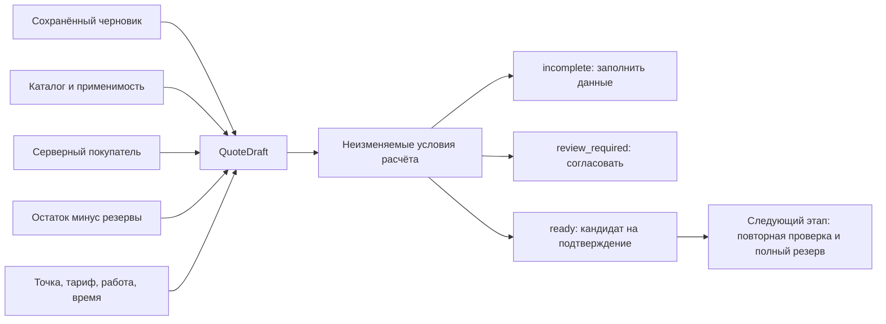

# Этап 2, часть 2 — сохраняемый расчёт и проверка условий

Дата отчёта: 21 сентября 2026 года; итоговый тестовый прогон выполнен 20 сентября. План — [MODERNIZATION_SPEC.md](../../MODERNIZATION_SPEC.md). Предыдущая часть — [деньги и постоянные черновики](10-order-core-foundation.md).

## 1. Реализовано

Расчёт черновика теперь сохраняется в PostgreSQL как отдельный снимок с UUID, последовательной версией, версией исходного черновика и сроком действия. Он использует конкретные предложения каталога, `Money`, актуальный контекст покупателя, свободный остаток, применимость и условия получения.

Первый пункт этапа 2 — DTO, деньги, постоянные черновики и версии расчёта — выполнен. Этап целиком остаётся в работе: общий поиск, идемпотентность, `SubmitDraft`, полный резерв, outbox и перевод входов ещё не завершены.

Магазин, оптовая форма и чат пока не подключены к новому ядру. HTTP API не открыто. Миграции этой части выполнялись только в тестовой БД. Расчёт не создаёт заказ, платёж, резерв или наряд.



## 2. Код и данные

| Компонент | Ответственность |
|---|---|
| `app/Domain/Pricing/QuoteDraft.php` | Подготовить, прочитать и повторно проверить расчёт |
| `app/Domain/Pricing/CalculateDraft.php` | Пакетно загрузить факты и посчитать товары |
| `app/Domain/Pricing/QuoteCalculation.php` | Снимок и закрытый отпечаток источников |
| `app/Domain/Pricing/QuoteIssues.php` | Причины проверки, ошибки заполнения и готовность |
| `app/Domain/Pricing/Models/CheckoutQuote.php` | Постоянная запись расчёта |
| `app/Domain/Pricing/Data/CheckoutQuoteView.php` | Публичное представление для владельца |
| `app/Domain/Catalog/CheckFitment.php` | Проверить выбранный артикул или применимость к машине |
| `app/Domain/Fulfillment/QuoteFulfillment.php` | Точка/тариф, услуги, время и доступность поста |
| `app/Domain/Ordering/DraftAccess.php` | Общий запрос черновика с обязательным ограничением владельца |
| `app/Domain/Shared/CanonicalJson.php` | Однозначное представление фактов без float и произвольных объектов |
| `app/Domain/Shared/Casts/ZonedTimestamp.php` | Сохранение новых дат с явным часовым смещением |

Миграция `2026_09_20_000002_create_checkout_quotes.php`:

- Добавляет предложению `auto_checkout_enabled = false`, `stock_verified_at`, `price_valid_until`.
- Добавляет `service_points.timezone`, по умолчанию `Asia/Qyzylorda`.
- Создаёт `offer_fulfillment_points`: разрешение конкретного предложения для самовывоза/установки в точке. Количеств и самостоятельных городских складов в этой таблице нет.
- Создаёт `checkout_quotes` с зашифрованным снимком, закрытым `source_hash`, автором, сроком и статусом.
- Уникальные индексы обеспечивают последовательный номер внутри черновика и не более одной записи `prepared` на черновик.

В ещё не выпущенной миграции черновиков имя конечного состояния приведено к спецификации: `archived` вместо `abandoned`. Рабочие данные не переводились и не удалялись.

## 3. Версия и жизненный цикл

### Подготовка

`QuoteDraft::prepare(buyer, draftId, expectedVersion)`:

1. Перечитывает серверный контекст покупателя.
2. Блокирует принадлежащий ему черновик и проверяет режим, версию, состояние `active`.
3. Рассчитывает текущие условия.
4. Присваивает расчёту следующий номер; прежняя подготовленная версия становится `superseded`.
5. Сохраняет снимок и срок действия, по умолчанию 15 минут.

Версия черновика при этом не увеличивается: исходный выбор не редактируется. Два самостоятельных параллельных вызова создают две последовательные версии расчёта. Последняя остаётся подготовленной; первая сохраняется для сравнения.

Это пока не идемпотентная команда. Повтор одного намерения должен быть перехвачен общим механизмом `Idempotency-Key` до открытия HTTP API. Нельзя считать две версии расчёта корректным результатом повтора одного сетевого запроса.

### Чтение

`get()` возвращает сохранённые условия. Он не пересчитывает сумму, не создаёт новую версию и не меняет БД ради чтения. По истечении срока представление показывает `expired`; при изменившейся версии черновика — `superseded`.

`readiness` описывает факты **на момент подготовки**. `status = prepared` означает, что версия ещё не заменена и не истекла; это не доказательство неизменности каталога за прошедшее время. Интерфейс должен учитывать и статус, и готовность, а сервер подтверждения всегда выполнять свежую проверку.

Суммы, исходная версия, отпечаток и срок не переписываются через модель. Для изменения условий создаётся новая запись. Статус может меняться отдельно. Защита неизменности сейчас действует на уровне модели/операций; прямые SQL-записи административным доступом не объявляются запрещёнными отдельным триггером.

### Повторная проверка

`assertCurrent()` требует внешнюю транзакцию будущего оформления. Проверяет владельца, доступ, версии, статус, срок; заново получает факты и сравнивает закрытый отпечаток.

Изменение товара, цены, доступного количества, скидки, точки, применимости, услуги или политики требует обновить условия. Текущий внутренний код такого результата — `QUOTE_CHANGED`. Истечение срока — `QUOTE_EXPIRED`; заменённая версия — `QUOTE_NOT_CURRENT`.

Эта проверка сама не принимает расчёт и не гарантирует резерв. В `SubmitDraft` ещё нужно обеспечить общий порядок блокировок **всех** ресурсов, включая персональные условия и расписание, и закончить проверку, резерв, заказ и outbox одной транзакцией. Сейчас гарантированно блокируются черновик и предложения; проверка расписания является чтением доступности.

## 4. Денежный результат

Поля снимка:

- `items`: конкретное предложение, исходная ссылка, артикул, производитель, количество, единичная цена, сумма, свободное количество, результат применимости.
- `service_items`: работы, связанные с товарными строками; цены и суммы.
- `goods_total`, `services_total`, `delivery_total`, `total` — `Money` либо `null`.
- `known_total` — сумма только известных составляющих.
- `readiness`, `reasons`, подробные `issues` с полем/строкой и степенью `incomplete` или `review`.
- Контакты, автомобиль и условия получения снимком.

`null` не заменяется нулём. Если одна обязательная составляющая неизвестна, окончательный `total = null`; известная часть сохраняется отдельно. Явная нулевая стоимость работы или доставки допускается. Нулевая/отрицательная товарная цена считается неизвестной.

Персональная цена берётся из текущего одобренного аккаунта. Телефон формы не ищет клиента и не открывает скидку. Скидка округляется для одной штуки, затем проверяется закупочный минимум, затем умножается количество. Если закуп неизвестен, личную цену нельзя гарантировать — она остаётся неизвестной. Закуп, внутренние условия и отпечаток не возвращаются клиенту.

Пример из тестов, не цена действующего каталога: 33.35 ₸ минус 10% даёт 30.02 ₸ за штуку и 90.06 ₸ за три. Оптовый расчёт при этом всегда имеет `WHOLESALE_REVIEW_REQUIRED`.

## 5. Готовность и факты каталога

| Состояние | Значение |
|---|---|
| `incomplete` | Нет состава, корректных контактов или обязательных данных получения |
| `review_required` | Данные сохранены, но условия нуждаются в согласовании |
| `ready` | На момент расчёта выполнены проверки; финальное подтверждение ещё должно перепроверить факты и получить полный резерв |

Для автоматического товарного пути требуются:

- Активное предложение и поставщик, опубликованный товар без флага ручной проверки.
- Явно включённый `auto_checkout_enabled`.
- Известная положительная KZT-цена и неистёкший `price_valid_until`.
- Проверка остатка не старше 24 часов и не из будущего.
- Свободного количества достаточно для всей строки.
- Выполнены условия выбранного способа подбора и получения.
- Розничный режим и соблюдённые лимиты.

Свободное количество — складской остаток минус все записи `held`. Истёкший по времени, но ещё не освобождённый резерв тоже удерживает товар; расчёт не освобождает его побочным действием. Это исключает обещание единицы, которая всё ещё числится отложенной.

Старые предложения остаются выключенными для автоматической продажи. Импорт, CRM-редактирование признаков актуальности и настройка допуска ещё должны быть связаны с новым ядром до выпуска. Нельзя включать автооформление массово только из-за наличия цены в прежней таблице.

## 6. Применимость

### `exact_article`

Требуются явные подтверждения артикула и производителя. Они сравниваются с сохранённым выбором: изменившийся код или производитель требует нового подтверждения. Пустой артикул не становится точным совпадением по одному названию.

Результат `exact_article` означает осознанный выбор товара, **не** подтверждение совместимости с автомобилем. Для установки этого недостаточно: необходима проверенная применимость к машине.

### `vehicle_fitment`

Используются подтверждённая строка `fitments`, модель, бренд при его передаче, год, поколение, кузов, число дверей и явно известные опции. В черновик добавлено необязательное поле `vehicle.doors`.

- Неизвестный год, неподтверждённая применимость или модель на проверке требуют менеджера.
- Проверяются границы годов применимости и выбранного поколения; чужое или неуказанное требуемое поколение не подходит автоматически.
- Кузов и двери сравниваются с ограничениями подтверждённой применимости.
- Свободное примечание в применимости требует проверки: код не пытается самостоятельно истолковать текстовое исключение комплектации.
- Обязательные технические опции заданы по типу стекла в `config/ordering.php`. Неизвестное значение не равно `false`; ответ «не знаю» возвращает перечень отсутствующих уточнений.
- Явно указанная противоречащая опция требует проверки.
- VIN, изображение и похожее название не заменяют подтверждённые связи каталога.

Общий поиск предложений ещё предстоит подключить к этим же правилам. Эта часть реализует проверку выбранного предложения.

## 7. Получение и услуги

### Самовывоз

Требуются город, активная точка этого города и явное разрешение предложения в `offer_fulfillment_points`. Наличие остаётся общим складским фактом. Связь с точкой означает допустимый способ получения, а не подтверждённое количество на отдельном городском складе.

### Доставка

Требуются адрес, контакты и серверная политика для города в `ordering.fulfillment.delivery_zones`. Сейчас это явно разрешённая доставка по всему указанному городу: целая сумма `fee_minor` и список допущенных поставщиков. Пустая конфигурация означает ручное согласование, а не бесплатную доставку.

Ключ города нормализуется по регистру и пробелам; это не геокодер и не проверка произвольного адреса на полигон. Перед выпуском согласовать реальные зоны/тарифы и использовать постоянные значения города в payload независимо от языка подписи интерфейса.

### Установка

- Допуск предложений к точке и проверенная применимость обязательны.
- Работа выбирается из активных услуг по типу стекла; точная услуга имеет приоритет перед общей. Затем используются порядок, цена и ID.
- Работа добавляется один раз отдельной строкой. Доставка при установке в точке равна нулю, повторного прибавления монтажной суммы нет.
- Общая длительность складывается из работ и одного буфера.
- Проверяются часовой пояс точки, её часы работы, шаг времени, запас до начала, горизонт записи и соответствие конца слота рассчитанной длительности.
- Занятость считается по максимальному одновременному пересечению нарядов. Два последовательных наряда не занимают два поста одновременно; касание концом одного слота начала другого разрешено.
- Количество одного стекла больше единицы требует проверки нескольких автомобилей.

Слот здесь ещё не бронируется. Защита от одновременной записи последнего свободного поста должна появиться в общей транзакции подтверждения.

### Выезд

Известная стоимость установки и одна плата за выезд отражаются в сумме. Выезд получает `VISIT_RESOURCE_REVIEW_REQUIRED`: текущая модель не связывает выездного сотрудника/ресурс с разрешённой зоной и выбранным временем. Цена услуги не является доказательством доступности мастера.

Автоматический выезд остаётся задачей дальнейшей реализации получения: нужны зоны, ресурсы, доступность и атомарный резерв. Текущая ручная ветвь не заменяет это требование целевого плана. Сценарий отдельной услуги без покупки стекла сохраняется в действующем приложении; его перевод на общее ядро также впереди.

## 8. Время, безопасность и производительность

Новые даты передаются в PostgreSQL с явным смещением. `stock_verified_at` и `price_valid_until` используют отдельный cast; модели новых таблиц сохраняют timezone в формате даты. Это устраняет обнаруженный сдвиг на пять часов при стандартном формате Eloquent без offset.

Внешние даты расчёта и слота выдаются в UTC. Рабочие часы интерпретируются в timezone точки. Существующие `assignments.scheduled_at` остаются `timestamp without time zone` в часовом поясе приложения; адаптер конвертирует границы запроса явно. Массовая смена трактовки старого расписания не выполнялась.

Снимок расчёта зашифрован, поскольку содержит контакты и адрес. `source_hash` — закрытый HMAC нормализованных фактов, включая персональные условия. Он позволяет обнаружить изменение источников и не раскрывается в DTO. Модель нельзя передавать в HTTP-ответ вместо DTO.

Предложения, товары, поставщики, применимость, поколения и резервы загружаются пакетно. Тест 500 строк ограничивает число SQL-запросов подготовки значением 20. Это проверка отсутствия запросов на каждую строку, а не измерение p95 под нагрузкой.

## 9. Проверки

Итоговый целевой набор: **281 тест / 836 assertions успешно**. Новые проверки этой части: **59 тестов / 220 assertions**. Включены регрессии черновиков, денег, корзины, опта, заказов, платежей, резервов, цен услуг и записи на установку. Полный набор проекта и браузерный выпуск этой частью не объявляются проверенными.

Основные доказательства:

- Цена, неизвестная составляющая, известный ноль, скидка и закупочный минимум.
- Изоляция владельцев, отзыв оптового доступа, сохранение старых сумм, версии, срок и повторная проверка изменившихся условий.
- Неизвестная камера, неверный кузов/год/бренд, поколение, двери, непроверенная применимость и изменившийся артикул.
- Точка получения, неизвестный/настроенный/нулевой тариф, отсутствующая/бесплатная работа, однократное прибавление установки и выезда.
- Слоты, требуемая длительность, пиковая занятость и соприкасающиеся интервалы.
- Переключение timezone соединения PostgreSQL между `America/New_York` и `UTC` сохраняет моменты новых дат и срок расчёта.
- Два независимых PHP-процесса одновременно ждут блокировку черновика; затем получают версии 1 и 2, в БД остаётся ровно одна `prepared`.
- 500 позиций рассчитываются пакетно с единым итогом; чтение/подготовка не создают заказов и резервов.
- Миграции поднимаются и откатываются через защищённую отдельную тестовую БД. Pint и `git diff --check` успешны.

Первый прогон выявил потерю timezone; она исправлена и покрыта отдельным тестом. Промежуточный тест отсутствующей услуги пытался записать `null` в прежнюю NOT NULL-колонку `services.price`; сценарий исправлен на реально допустимое отсутствие услуги. Схема услуг ради теста не ослаблялась.

```powershell
./scripts/test.ps1 tests/Unit/MoneyTest.php tests/Unit/CustomerPriceCalculatorTest.php tests/Unit/CanonicalJsonTest.php tests/Feature/Domain tests/Feature/WholesaleTest.php tests/Feature/CartTest.php tests/Feature/OrderTest.php tests/Feature/PaymentTest.php tests/Feature/StockReservationTest.php tests/Feature/ServicePricingTest.php tests/Feature/BookingTest.php --log-junit .codex/modernization/quotes-final-tests.xml

& C:/php/php.exe vendor/bin/pint --test app/Domain app/Models/Offer.php config/ordering.php tests/Feature/Domain tests/Support/draft-concurrency-worker.php tests/Support/BuildsQuoteFixtures.php tests/Support/BuildsVerifiedQuoteFixture.php tests/Unit/CanonicalJsonTest.php database/migrations/2026_09_20_000001_create_order_drafts.php database/migrations/2026_09_20_000002_create_checkout_quotes.php

git diff --check
```

Успешные артефакты: `.codex/modernization/quotes-final-tests.{log,xml}`, `quote-style.log`. `quotes-first-tests.*` и `quotes-domain-tests.*` относятся к промежуточным прогонам с описанными ошибками.

## 10. Следующие инструкции исполнителю

Обновление от 21 сентября: пункты 1–2 выполнены в [части 3 — идемпотентные команды и API](12-idempotency-api.md). API остаётся выключенным по умолчанию; дальнейшая работа начинается с общего поиска и `SubmitDraft`. Числа тестов выше относятся к завершению именно части 2.

1. Реализовать `idempotency_records` и общую обёртку команд: владелец + операция + ключ, нормализованный fingerprint входа, одновременные повторы, возврат того же результата, конфликт изменённого содержимого. Учесть приватность и срок хранения результатов.
2. Обернуть создание/изменение черновика и подготовку расчёта, затем реализовать session/CSRF API, единый формат ответов, лимиты запросов и локализованные ошибки. Пока это не готово, не открывать прямые маршруты к существующим методам.
3. Добавить общий поиск и переиспользовать `CheckFitment`; сохранять различие точного артикула и проверенной совместимости.
4. Реализовать `SubmitDraft` с явным действием клиента. При изменении фактов вернуть свежие условия для повторного согласия; не превращать подтверждение покупки в заявку незаметно.
5. В одной транзакции выполнить окончательную проверку персональных условий, товарных предложений и расписания, получить полный резерв, создать заказ и outbox. Проверить конкуренцию последней единицы товара и последнего поста отдельными процессами.
6. Добавить управляемые настройки допуска предложений/точек, актуальности импорта, доставки и выездных ресурсов. Затем подключать реальные интерфейсы и совместимые старые формы по этапам.

Не принимать `source_hash`, цены, скидки, готовность или владельца из браузера/ИИ как подтверждённые данные. Кнопка подтверждения использует ID расчёта и ожидаемую версию, а всю проверку выполняет backend.
