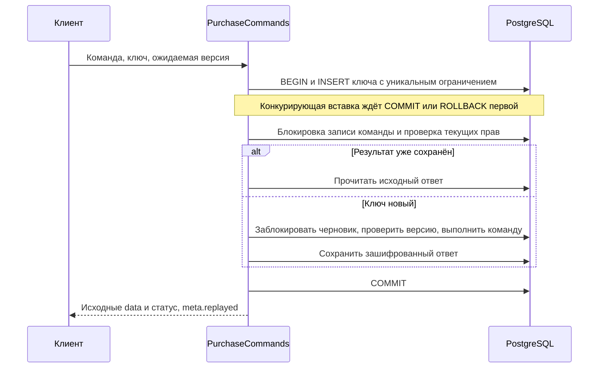

# Этап 2, часть 3 — повторяемые команды и API черновика

Дата: 21 сентября 2026 года. Основной план — [MODERNIZATION_SPEC.md](../../MODERNIZATION_SPEC.md). Предыдущая часть — [расчёт и проверка условий](11-checkout-quotes.md).

## 1. Результат и границы

Добавлена общая точка записи `PurchaseCommands`: создание и изменение черновика, подготовка расчёта. Повтор одного действия с тем же ключом возвращает сохранённый результат. Изменение содержимого под уже использованным ключом возвращает конфликт. Команда и её ответ фиксируются в одной транзакции PostgreSQL.

Для этих операций подготовлено внутреннее session/CSRF API `/api/v1`. Оно проверяет владельца, типы JSON, права на опт и ограничения запросов, возвращает ошибки на русском и казахском. Все маршруты находятся в группе `web`, несмотря на префикс `api`.

**API выключено по умолчанию:** `ORDERING_API_ENABLED=false`. Рабочая `.env` не изменялась. Новая миграция выполнялась только в выделенной тестовой БД. Магазин, оптовая таблица, старый чат и прототипы ещё не переведены на эти операции. Заказ, платёж, товарный резерв и запись на пост здесь не создаются. `SubmitDraft` и общее резервирование остаются следующим этапом.

## 2. Файлы и ответственность

| Файл или каталог | Ответственность |
|---|---|
| `app/Domain/Shared/Commands/Idempotency.php` | Уникальный ключ, fingerprint входа, транзакция, повтор и очистка ответа |
| `app/Domain/Shared/Commands/CommandResult.php` | Публичные данные, HTTP-статус успеха, признак повтора |
| `app/Domain/Shared/Commands/IdempotencyRecord.php` | Зашифрованный сохранённый ответ |
| `app/Domain/Ordering/PurchaseCommands.php` | Общие команды для будущих HTTP, Livewire и ИИ-адаптеров |
| `app/Http/Controllers/Ordering/DraftController.php` | Разрешённые входные поля и вызов общего слоя |
| `app/Http/Middleware/OrderingApiBoundary.php` | Feature flag, допустимое хранилище сессии/блокировок, исходный типизированный JSON |
| `app/Http/Middleware/OrderingBuyer.php` | Покупатель из серверной сессии или авторизованного аккаунта |
| `app/Http/Ordering/ApiResponse.php` | Формат ответа, локализация и безопасная обработка ошибок |
| `routes/ordering.php` | Шесть маршрутов, лимиты и блокировка сессии |
| `lang/ru/ordering.php`, `lang/kk/ordering.php` | Сообщения ошибок и валидации |
| `database/migrations/2026_09_21_000001_create_idempotency_records.php` | Таблица команд и ограничения PostgreSQL |
| `app/Console/Commands/PruneIdempotencyResults.php` | `ordering:prune-idempotency` |

Контроллеры не принимают `customer_id`, гостевой секрет, скидку, цену, доступный остаток или готовность заказа. Данные владельца создаются сервером. Чтение возвращает DTO с разрешёнными полями, а не сериализованную модель Eloquent.

## 3. Контракт команды

### 3.1. Ключ и входные данные

- `Idempotency-Key`: 1–128 символов, разрешены латинские буквы, цифры, `.`, `_`, `:`, `-`. Клиенту удобно использовать случайный UUID.
- Одна логическая команда получает один ключ до первой отправки. После сетевого сбоя, двойного нажатия или временной ошибки повторяется тот же ключ с тем же содержимым.
- Область уникальности: владелец + серверное имя операции + SHA-256 ключа. Имена операций: `draft.create.v1`, `draft.update.v1`, `draft.quote.v1`.
- Один ключ можно использовать в разных операциях, но клиенту проще выдавать новый ключ каждому отдельному действию. Повторное создание другого черновика с тем же ключом вернёт первый черновик.
- Fingerprint учитывает ID черновика, ожидаемую версию и изменения. Для создания он включает режим продажи и язык покупателя из `X-Locale`.
- Вход нормализуется через `CanonicalJson`: порядок ключей объекта не важен, порядок строк списка и типы значений важны. `1`, `"1"`, `true` не взаимозаменяемы. Числа с плавающей точкой не допускаются общим слоем команд.
- Fingerprint хранится как HMAC с ключом приложения. Исходный запрос и исходный ключ в таблицу не записываются.

### 3.2. Транзакция и конкуренция



Правила реализации:

1. Сначала запись идемпотентности, затем черновик, затем необходимые данные каталога/ресурсы. Следующие команды должны соблюдать общий порядок блокировок.
2. После ожидания конкурента повторно загрузить текущий аккаунт. Даже выдача старого ответа требует актуального доступа к ресурсу и режиму продажи.
3. При одинаковом входе вернуть сохранённые `data` и HTTP-статус. При другом входе вернуть `409 IDEMPOTENCY_CONFLICT`.
4. Проверку старой `expected_version` не повторять при выдаче сохранённого ответа: после успешной записи версия уже увеличилась.
5. Ошибка валидации, исключение или откат транзакции отменяют и бизнес-изменение, и новую запись ключа. Незавершённый ключ не блокирует исправленный запрос навсегда.
6. Внутри callback разрешены операции БД. Банк, SMS, ИИ, письма и другие внешние эффекты сюда не помещать. Будущая отправка выполняется через outbox после фиксации транзакции.
7. Транзакционные повторы при deadlock ограничены тремя попытками. Это ещё одна причина не выполнять внешние эффекты внутри callback.

Проверены два настоящих конкурирующих PHP-процесса и отдельное соединение первого исполнителя. Пока первая транзакция держит незавершённую вставку ключа, оба процесса ждут блокировку PostgreSQL. После её отката одинаковые команды создают один черновик; один процесс выполняет команду, второй получает повтор. При разных данных один процесс получает конфликт.

### 3.3. Что означает повтор

Повтор возвращает **снимок результата прежнего действия**, а не актуальное состояние объекта. Например, повтор изменения версии 1 возвращает сохранённую версию 2, даже если черновик позже перешёл к версии 3. Версия 3 при этом не меняется.

То же относится к расчёту: повтор подготовки может вернуть исходное `status=prepared`, хотя расчёт уже истёк или заменён. Перед показом действующей готовности прочитать расчёт через GET и учитывать `expires_at`. Финальное подтверждение в будущем в любом случае повторно проверяет условия на сервере.

Гарантия действует внутри одного владельца и операции. Вход в другой аккаунт, потеря гостевой сессии или смена владельца — другой контекст. Автоматический перенос гостевого черновика в аккаунт здесь ещё не реализован; нельзя обходить это поиском по номеру телефона.

## 4. Инициализация сессии и доступ

1. Клиент сначала выполняет `GET /api/v1/session` с `Accept: application/json`, `X-Locale: ru` или `kk` и cookies текущего сайта. Дождаться ответа до первой команды записи.
2. Для гостя сервер создаёт случайный 256-битный секрет, сохраняет его в серверной сессии. В БД черновика сохраняется его SHA-256. Секрет не попадает в JSON.
3. Ответ содержит `csrf_token`, `locale`, `authenticated`. Передавать полученный токен как `X-CSRF-TOKEN` вместе с cookies при каждой записи.
4. Без инициализированного гостевого владельца бизнес-маршруты возвращают `409 SESSION_REQUIRED`. При отсутствующем CSRF запись может быть отклонена раньше с `419`.
5. Каждая штатная API-route использует `block(30, 10)`: срок блокировки сессии 30 секунд, ожидание до 10 секунд. Это защищает короткую инициализацию владельца и запись сессии между вкладками. Атомарность бизнес-команд обеспечивается БД независимо от этой блокировки.
6. При истечении ожидания блокировки — `503 SESSION_BUSY` и `Retry-After: 1`; повторить тот же запрос, не создавая новый ключ.
7. Поддерживаются серверные session drivers `file`, `database`, `redis`, `memcached`, `dynamodb` и хранилища блокировок на этих драйверах. `array` разрешён только в тестах. `cookie`, отсутствующий или неподдерживаемый драйвер дают `503 DEPENDENCY_UNAVAILABLE` до старта сессии.
8. При нескольких экземплярах приложения сессия, блокировки и лимиты должны использовать общие хранилища. Локальный `file` пригоден только для соответствующей односерверной схемы. Наличие имени драйвера в конфигурации не доказывает доступность сервиса: эксплуатационный readiness остаётся отдельной задачей.

Авторизованный клиент определяется по текущему `User` и привязанному `Customer`. Неактивный аккаунт, сотрудник или аккаунт без клиента получает `401 AUTH_REQUIRED`. Подтверждённый опт проверяется на сервере; сам номер телефона не даёт скидку и доступ. Номер в контактах черновика не является подтверждённой личностью.

Это адаптер существующей авторизации. Реальная OTP-процедура и восстановление доступа на другом устройстве относятся к этапу 3. Срок доступа гостя пока зависит от существующей сессии, а не от срока хранения строки черновика в БД.

## 5. HTTP API

### 5.1. Общие правила

- Все URL ниже относительно корня приложения. При размещении в подпути использовать URL, созданные серверным `route()`, с учётом доверенного reverse proxy. Не зашивать `/api/v1` от корня домена в будущем frontend.
- Запись принимает JSON-объект, максимум 1 MiB, глубина до 64. Массив/строка/null в корне отклоняются.
- `Content-Type: application/json`, `Accept: application/json`; для записи обязательны `Idempotency-Key`, cookies и CSRF.
- `X-Locale` принимает только `ru`/`kk`, значение по умолчанию `ru`. Оно задаёт язык сообщений текущего запроса. Чтобы изменить сохранённый язык черновика, передать `changes.locale`.
- Исходные типы JSON сохраняются до глобальных преобразований строк Laravel. Неизвестные поля отклоняются, значения не преобразуются молча в нужный тип.
- Лимит всего API — 60 запросов в минуту; запись дополнительно ограничена 20 запросами в минуту. Повторы тоже учитываются. Используется стандартная область Laravel throttle: авторизованный пользователь либо IP/домен гостя. Общий IP может объединять лимит нескольких посетителей; перед выпуском оценить это на реальном трафике.
- Все ответы: `Cache-Control: no-store, private`, `Content-Language`, `X-Content-Type-Options: nosniff`. Персональные DTO нельзя кэшировать в CDN, service worker или общедоступном кеше.

### 5.2. Маршруты

| Метод | URL | Вход | Успех |
|---|---|---|---|
| GET | `/api/v1/session` | Заголовок языка | 200, CSRF и состояние входа |
| POST | `/api/v1/drafts` | `sales_mode`: `retail`/`wholesale`, по умолчанию `retail` | 201, DTO черновика версии 1 |
| GET | `/api/v1/drafts/{draft}` | UUID черновика | 200, актуальный DTO владельца |
| PATCH | `/api/v1/drafts/{draft}` | `expected_version`, `changes` | 200, сохранённый DTO новой версии |
| POST | `/api/v1/drafts/{draft}/quotes` | `expected_version` | 201, сохранённый расчёт |
| GET | `/api/v1/drafts/{draft}/quotes/{quote}` | UUID черновика и расчёта | 200, исходные условия и актуальная доступность версии |

GET не создаёт черновик или расчёт. Инициализация сессии меняет только техническую сессию. Эндпоинта отправки заказа в этой части ещё нет.

### 5.3. Примеры входа

Создание, отдельный новый ключ:

```json
{"sales_mode":"retail"}
```

Изменение контактов, другой новый ключ:

```json
{
  "expected_version": 1,
  "changes": {
    "contacts": {"name": "Покупатель", "phone": "+77001234567"},
    "fulfillment": {"type": "pickup", "city": "Алматы"}
  }
}
```

Это пример структуры, не готовый к покупке заказ. Без товара и проверенной точки расчёт будет неполным.

Разрешённые группы изменений:

| Группа | Поля и поведение |
|---|---|
| `items` | Полная замена списка; отсутствие поля сохраняет позиции, `[]` очищает |
| Одна позиция | `line_id`, `offer_id`, `reference`, `quantity`, `comment`, `selection_mode`, `article_confirmed`, `manufacturer_confirmed` |
| `contacts` | Частичное изменение `name`, `phone` |
| `vehicle` | `brand_id`, `model_id`, `generation_id`, `year`, `body`, `doors`, `vin`, `options` |
| `vehicle.options` | Только флаги из `Product::OPTION_FLAGS`; `true`/`false`/`null`, где `null` означает неизвестность |
| `fulfillment` | `type`, `city`, `address`, `service_point_id`, `slot_start`, `slot_end` |
| `locale` | `ru` или `kk` |

Количество, ID и версия передаются целыми JSON-числами. `doors` пока строка, как в модели применимости. Даты слота: `YYYY-MM-DDTHH:mm:ss+HH:mm`. `selection_mode`: `vehicle_fitment` или `exact_article`. `line_id` — стабильный UUID позиции. Для нерешённой позиции допускается `offer_id=null` при непустом `reference`; такая строка не допускается к автоматической покупке.

Метаданные изменяются частично; `null` очищает разрешённое конечное поле. Верхнеуровневые группы не заменяются на `null`. Снимки названия, производителя и артикула формирует сервер. Повторяющиеся предложения не объединяются автоматически.

Подготовка расчёта использует версию из ответа последнего сохранения:

```json
{"expected_version":2}
```

### 5.4. Формат ответа и ошибок

Успех: `{ "data": { ...DTO }, "meta": { "request_id": "серверный UUID", "replayed": false } }`. `replayed` присутствует у команд; чтение содержит только `request_id`. При повторе `data` и статус исходные, а `request_id` новый.

Пример конфликта версии:

```json
{
  "error": {
    "code": "DRAFT_VERSION_CONFLICT",
    "message": "Черновик изменился. Загрузите свежую версию и сравните изменения.",
    "fields": {},
    "current_version": 3
  },
  "meta": {"request_id": "<server-generated-uuid>"}
}
```

Ошибки полей находятся в `error.fields`, например `items.0.quantity: ["..."]`. Только `current_version` и `result_id` из разрешённых деталей могут попасть в публичную ошибку. Стек, SQL, секреты, закупочная цена и исходный текст неизвестного исключения не возвращаются даже при `APP_DEBUG=true`.

| Код / статус | Действие будущего интерфейса |
|---|---|
| `DRAFT_VERSION_CONFLICT` / 409 | Получить свежий черновик, сравнить изменения, затем сформировать осознанное новое действие с новым ключом |
| `IDEMPOTENCY_CONFLICT` / 409 | Восстановить предыдущее действие; не обходить конфликт автоматической генерацией нового ключа |
| `IDEMPOTENCY_RESULT_EXPIRED` / 409 | Проверить ресурс по `result_id`, прежде чем разрешать новое действие |
| `SESSION_REQUIRED` / 409 | Инициализировать сессию; если она была потеряна, сначала разобраться с принадлежностью прежнего черновика |
| `CSRF_TOKEN_MISMATCH` / 419 | Получить актуальный CSRF; повторять прежнюю команду только в том же подтверждённом контексте владельца |
| `AUTH_REQUIRED` / 401 | Восстановить допустимый покупательский вход |
| `WHOLESALE_REQUIRED` / 403 | Объяснить отсутствие подтверждённого оптового доступа |
| `RESOURCE_NOT_FOUND` / 404 | Показать недоступность ресурса; чужой и отсутствующий UUID не различать |
| `VALIDATION_FAILED` / 422 | Показать ошибки конкретных полей; команда не применена |
| `INVALID_JSON` / 400, `UNSUPPORTED_MEDIA_TYPE` / 415, `PAYLOAD_TOO_LARGE` / 413 | Исправить клиентский запрос |
| `RATE_LIMITED` / 429 | Уважать `Retry-After` |
| `SESSION_BUSY` / 503 | Уважать `Retry-After`, повторять тот же ключ и вход |
| `INTERNAL_ERROR` / 500, сетевой обрыв | Результат может быть неизвестен клиенту; повторять исходную команду с тем же ключом |

`request_id` создаётся сервером и позволяет интерфейсу указать идентификатор ответа. Связь с централизованной трассировкой ещё не реализована; это не заявление о готовом мониторинге.

## 6. Хранение и очистка

`idempotency_records` содержит область владельца, имя операции, хэши ключа/входа, статус ответа, зашифрованный DTO, UUID результата и даты с timezone. Уникальный индекс запрещает дубли ключа в одной области. Ограничение БД допускает сохранённый успешный статус 200–299 либо ещё незавершённую запись внутри транзакции.

Полный ответ доступен для повтора 24 часа от начала команды, параметр `ordering.idempotency_result_hours` (1–720 часов). Даже до запуска очистки истёкший ответ не выдаётся. После истечения команда очистки удаляет payload, сохраняя минимальную запись ключа, fingerprint и ссылку на результат. Старый ключ **не получает право выполнить действие заново**.

```powershell
& C:/php/php.exe artisan ordering:prune-idempotency
```

Команда подключена к часовому расписанию Laravel и защищена от наложения запусков. При выключенном `ORDERING_API_ENABLED` она ничего не меняет, чтобы не обращаться к ещё не созданной таблице. Реальный scheduler на рабочем сервере в этой части не запускался и не проверялся. Если API отключено длительно после эксплуатации, отдельный эксплуатационный порядок очистки должен сохранить сроки удаления приватных payload.

Не удалять строки ключей массово «для ускорения»: это снимет защиту старых повторов. Долговременный рост минимальных записей, удаление данных владельца и архивирование требуют отдельной политики перед рабочим выпуском. Текущая очистка выполняет один SQL UPDATE; пакетная обработка нужна по фактическому объёму, её нагрузочный тест ещё впереди.

Ключ приложения нужен для расшифровки сохранённых ответов и проверки HMAC. При его ротации необходим план совместимости: текущий алгоритм входного HMAC не перебирает прежние ключи, поэтому старый запрос может получить конфликт. Ротация и восстановление из backup в этой части не тестировались. Не менять ключ на рабочей системе как способ очистить ответы.

## 7. Исправление найденного расхождения времени

Итоговый прогон выявил плавающее отличие `updated_at` на одну секунду между результатом изменения черновика и последующим GET. Причина подтверждена кодом установленного Laravel: если время модели совпало с предыдущим сохранением, поле отсутствует в изменённых атрибутах; SQL builder может добавить более свежую отметку времени.

Теперь после UPDATE DTO строится из повторно прочитанной модели внутри той же транзакции и под той же блокировкой черновика. Отдельный тест управляет часами и часовым поясом соединения: без исправления он воспроизводит ошибку, с исправлением ответ точно совпадает с БД. Сравнение полного DTO в прежних тестах сохранено. Добавленный SELECT учитывается прежним ограничением числа запросов на 500 позиций.

## 8. Проверки

Итоговый целевой прогон: **350 тестов / 1117 assertions успешно**, 117 секунд, 21 сентября 2026 года. Новые проверки этой части, включая воспроизведение расхождения времени: **32 теста / 207 assertions**. Pint и `git diff --check` успешны. `route:list` подтверждает шесть маршрутов с группой `web` и отдельными лимитами чтения/записи.

Покрытие новой части:

- Повтор создания, изменения и расчёта; оригинальные данные/статус; отсутствие второй записи и отката более новых изменений.
- Канонический порядок полей, разные владельцы, конфликт другого содержимого, отзыв оптового допуска даже для сохранённого ответа.
- Откат после бизнес-изменения, исправление валидации, срок хранения, очистка ответа с сохранением ключа.
- Два независимых конкурирующих PHP-процесса после отката первого исполнителя: одинаковый и разный вход.
- Feature flag, bootstrap гостя, неизменность его секрета, недопустимое хранилище сессии/блокировок.
- Полный API-путь до расчёта, чужие UUID, внедрение цены/владельца, строгие типы/JSON/размер, RU/KK и отсутствие отладочных секретов.
- Настоящий `PreventRequestForgery` включён в отдельном тесте: отсутствующий CSRF отклонён, корректный принят.
- 20 записей в минуту допускаются, 21-я возвращает 429 с `Retry-After`; таймаут блокировки имеет отдельный безопасный ответ.
- Детерминированная проверка времени сохранения и прежние регрессии ядра/корзины/опта/заказов/платежей/услуг/навигации/языков/подпути.

Команды из корня репозитория:

```powershell
./scripts/test.ps1 tests/Unit/MoneyTest.php tests/Unit/CustomerPriceCalculatorTest.php tests/Unit/CanonicalJsonTest.php tests/Feature/Domain tests/Feature/OrderingApiTest.php tests/Feature/WholesaleTest.php tests/Feature/CartTest.php tests/Feature/OrderTest.php tests/Feature/PaymentTest.php tests/Feature/StockReservationTest.php tests/Feature/ServicePricingTest.php tests/Feature/BookingTest.php tests/Feature/StorefrontModeTest.php tests/Feature/LocalizationTest.php tests/Feature/SubpathTest.php --log-junit .codex/modernization/idempotency-final-recheck.xml

& C:/php/php.exe vendor/bin/pint --test app/Domain app/Http/Controllers/Ordering app/Http/Ordering app/Http/Middleware/OrderingApiBoundary.php app/Http/Middleware/OrderingBuyer.php app/Console/Commands/PruneIdempotencyResults.php bootstrap/app.php routes/ordering.php routes/web.php routes/console.php config/ordering.php lang/ru/ordering.php lang/kk/ordering.php database/migrations/2026_09_21_000001_create_idempotency_records.php tests/Feature/Domain tests/Feature/OrderingApiTest.php tests/Support/draft-concurrency-worker.php

& C:/php/php.exe artisan route:list --path=api/v1 --json
git diff --check
```

Среда: PHP 8.4.23, PostgreSQL на `127.0.0.1:5440`, БД `avtoglasskz_test`. Защита тестовой БД выполняется до миграций и в дочерних процессах. Рабочая и preview-базы не мигрировались. Внешние HTTP-запросы в тестах запрещены. Это целевой набор, а не полный тестовый прогон проекта и не нагрузочное измерение p95. Браузерная проверка не выполнялась: интерфейсы пока не подключены.

Успешные артефакты: `.codex/modernization/idempotency-final-recheck.{log,xml}`, `idempotency-style-final.log`. Список маршрутов: `ordering-api-routes.json` в том же каталоге. Более ранний `idempotency-final-tests.*` содержит найденное расхождение времени; `draft-timestamp-reproduction.*` — намеренное воспроизведение без исправления. `idempotency-fixes-tests.*` относится к промежуточной настройке тестовых часов; не использовать эти файлы как успешный итог.

## 9. Следующие инструкции исполнителю

1. Общий `SearchOffers` должен использовать те же правила применимости и расчёта персональной цены, что `CheckFitment` и `CalculateDraft`. Проверить точный артикул, неопределённость комплектации, лимиты выдачи и пакетные запросы. Не возвращать закупочную цену в DTO.
2. Для `SubmitDraft` принимать ID расчёта, ожидаемую версию и отдельное явное действие клиента. Подключить его к `PurchaseCommands` с новым серверным именем операции и тем же механизмом повторов.
3. В общей транзакции заново проверить владельца и оптовые условия, все значимые факты расчёта и выбранный сценарий. Текущий `QuoteDraft::assertCurrent` сам по себе ещё не обеспечивает блокировку всех изменяемых условий и расписания.
4. Для автоматической покупки получить полный резерв товара и слота, создать заказ, связь с расчётом и outbox. При изменении условий вернуть их на новое согласие; не менять покупку на заявку незаметно.
5. Проверить конкурентные покупки последней единицы и запись последнего поста независимыми процессами, откат любого неполного резерва, потерю ответа после COMMIT и повтор `SubmitDraft`.
6. Отдельно завершить модель ресурсов/зон для автоматического выезда и перенос заказа услуги без стекла. Текущая ручная ветвь не заменяет эти требования.
7. Затем подключить общий frontend-адаптер: bootstrap, серверные URL, cookies/CSRF, постоянный ключ незавершённого действия, восстановление после конфликта и повторное чтение актуального состояния. Не генерировать новый ключ автоматически после неизвестного результата.
8. Поэтапно перевести магазин, оптовую форму и инструменты ИИ на общее ядро. Прежние обработчики создания заказа не должны оставлять обход полного резервирования. Сохранить совместимость старых заказов, документов и платежей.
9. После этого отмечать оставшиеся пункты этапа 2 и переходить к настоящему входу/кабинету этапа 3. Наличие API черновика не означает готовность рабочего checkout.
